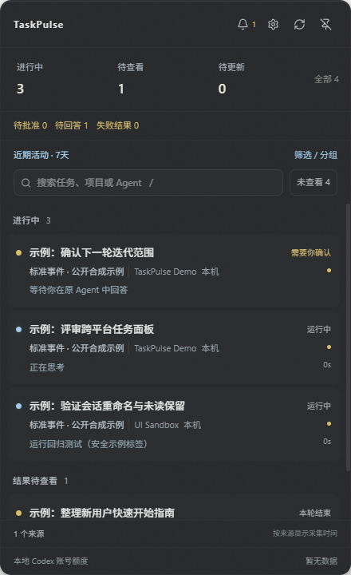
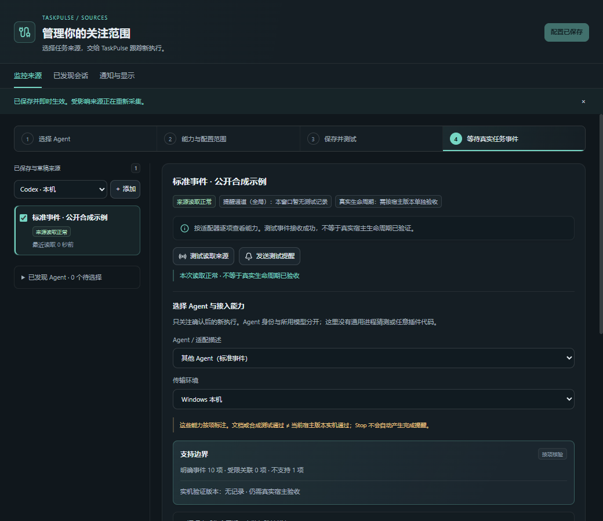
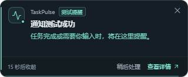

# TaskPulse

**Less window switching. More focus. Multiple coding agents, one task overview.**

[中文](README.md) · [Getting started](docs/INSTALL.md) · [Compatibility](docs/AGENT_COMPATIBILITY.md) · [Contributing](CONTRIBUTING.md) · [Issues](https://github.com/qingtian-4/TaskPulse/issues)

TaskPulse is a Windows-first desktop tray companion, not a VS Code extension. It brings tasks across agents, projects and machines into a dynamic attention list: what is running, what needs input, and which results you have not viewed. Independent reminders let you leave the dashboard closed while you work.

> **Current version: 0.2.0-alpha.7. No Alpha.7 installer is publicly available; run from source for now.** Windows Quality / Security CI and publishing an accepted installer are separate milestones. Passing CI is not clean-system, installer or sustained real-host acceptance.

## See it in action

The product uses a compact dark dashboard, an independent source manager and narrow reminders. See [screenshots and input provenance](assets/README.md). Upstream AgentTray images are not presented as TaskPulse screenshots.



<details>
<summary>Source management and independent reminder</summary>





</details>

Actual Windows Tauri / WebView2 rendering with isolated, public **synthetic standard events**; the reminder is explicitly a test. These are not browser mocks, real Agent conversations or proof of host compatibility. The current UI is Chinese. [Reproduction and validation](docs/VISUAL_POLISH_VALIDATION_2026-10-21.md)

## Keep your attention on the work

- **Watch several agents together.** Task titles, projects, agent identity and observed activity are separate. Thinking and model waits remain running.
- **Follow work, not idle history.** New executions join automatically; unviewed results and unresolved requests stay available. Pin important sessions.
- **Get reminded away from the dashboard.** Turn ends and failures differ from explicit approvals/questions. Closing a reminder does not mark a task viewed or approve a command.
- **Separate environments.** Choose local, WSL and SSH sources and project scopes. An old project executing again can re-enter attention without manual task registration.
- **See uncertainty honestly.** Lost sources, bad records and catch-up are not success. Silence, low CPU and tool returns never prove an agent turn ended. No invented progress percentage.

Use it while one agent reviews code, another fixes tests, and a server runs an experiment in tmux. TaskPulse helps you decide when to switch back; it does not replace the agent's conversation or approval UI.

## Install and get started

Use source builds today: [Releases](https://github.com/qingtian-4/TaskPulse/releases) has no public Alpha.7 installer. Source archives are not installers, and old AgentTray packages are not TaskPulse. Future Windows x64 naming and acceptance gates are in [Releasing](docs/RELEASING.md).

Prepare Rust 1.89+, Bun and [Tauri prerequisites](https://v2.tauri.app/start/prerequisites/). Standard Windows development includes Microsoft C++ Build Tools and WebView2.

```powershell
git clone https://github.com/qingtian-4/TaskPulse.git
cd TaskPulse
bun install --frozen-lockfile
bun run tauri dev
```

1. Discover or choose your agent in source management and review its capabilities.
2. Configure the environment and projects, then save. New sources watch all projects' new executions; existing allowlists are preserved.
3. Test reading and reminders, then start real work in the agent. **A successful test reminder does not verify real lifecycle delivery.**
4. Open the tray or press `Ctrl+Shift+A`. Mark results viewed after reading; answer and approve requests in the original agent.

See [Installation](docs/INSTALL.md), [the user guide](docs/PRODUCT_DASHBOARD.md) and [Development](docs/DEVELOPMENT.md) for configuration, Claude Code / CC Switch, server `tp-run`, privacy and troubleshooting. WSL and SSH are opt-in; stopped distributions are not woken and servers are not all connected automatically. Detailed guides currently use Chinese, with command examples.

## Agent support matrix

Adapters do not guarantee every host version. Installation discovery, successful reading, notification tests and real lifecycle verification are separate evidence. WSL means observing Linux data from the Windows application.

| Agent / source | Local | WSL | SSH | Important boundary |
|---|---|---|---|---|
| Codex | Native adapter | Separate source | Native session collection | Only explicit approval events notify; large cold logs need catch-up |
| Claude Code | Native records; optional explicit hooks | No dedicated adapter | No dedicated adapter | Proxy models do not change agent identity; hooks require consent |
| Hermes | SQLite / runtime leases | No dedicated adapter | No dedicated adapter | Lease loss is not completion; missing end evidence remains uncertain |
| DeepSeek Harness | Desktop / CLI | Separate source | No dedicated adapter | Legacy / v4 compressed logs and native title projections |
| Gemini CLI | Legacy hooks / process scanning | No dedicated adapter | No dedicated adapter | Not a full native conversation adapter |
| Kimi Code CLI / TRAE CN IDE / ZCode | **Partial mappings, fixture-tested** | Generic transport not implemented | Generic transport not implemented | No host Hook version verified; Stop is not final completion |
| WorkBuddy Desktop | **Candidate only, no event adapter** | Not implemented | Not implemented | CodeBuddy CLI does not establish Desktop support |
| Custom / community agent | Local v1 events / declarative manifest | Not implemented | Not implemented | Self-reported evidence, not official native support |
| Ordinary code runs | Unified workflow incomplete | No dedicated provider | tmux / `tp-run` | Foreground exit codes do not prove detached, container or Slurm completion |

See [per-capability support and verified versions](docs/AGENT_COMPATIBILITY.md). Discovering a process does not establish conversation, title or approval access.

## Architecture and extension

```text
Provider → scope / normalization / dedup → TaskStore
         → AttentionTracker → TransitionEngine → tray / UI / reminders
```

Rust / Tauri 2 handles collection and state; Svelte 5 handles presentation. Stable session/turn identity is separate from titles, phases and delivery. Renames do not create tasks; tool completion does not end a turn.

There is no TaskPulse cloud account or telemetry service. Settings and attention live in `~/.taskpulse/`; activity and diagnostics can contain commands or paths, so review them before sharing. TaskPulse never auto-installs real hooks, changes proxy/model settings or relaxes approval policies. Local Codex quota is account data, not task progress or remote-account quota.

Prefer explicit lifecycle events, then verifiable read-only data. See [Architecture](docs/ARCHITECTURE.md), [Integration guide](docs/AGENT_INTEGRATION_GUIDE.md) and [v1 protocol](docs/AGENT_INTEGRATION_PROTOCOL.md). There is no general executable third-party plugin loader.

## Roadmap

- Alpha.7: collect real-version, notification and sustained-runtime evidence; complete Windows installer acceptance.
- Onboarding: reduce setup friction and verify Kimi / TRAE / ZCode / WorkBuddy individually, without promoting candidates to full support.
- Environments: add missing Claude / Hermes transports and a unified local/WSL/SSH code-run workflow.
- Optional information: independently control account-quota querying and display.

These are future directions, not current promises. Completed bounded-log, checkpoint-recovery and cache work is in [Reliability optimization](docs/RELIABILITY_OPTIMIZATION_2026-10.md); remaining gates are in the [delivery checklist](docs/OPEN_SOURCE_CHECKLIST.md).

## Contributing / Credits

Read [CONTRIBUTING.md](CONTRIBUTING.md) before contributing. Bug reports should include OS, agent version and source type, with private conversations and credentials removed. Development and native acceptance commands are in [AGENTS.md](AGENTS.md).

Derived from [sprklai/agenttray](https://github.com/sprklai/agenttray). Upstream authors, copyright and Git history are preserved under the [MIT License](LICENSE). Thanks to AgentTray for the tray, terminal-focus and hook-bridge foundations.
