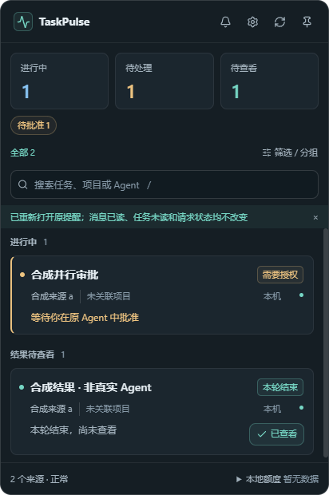
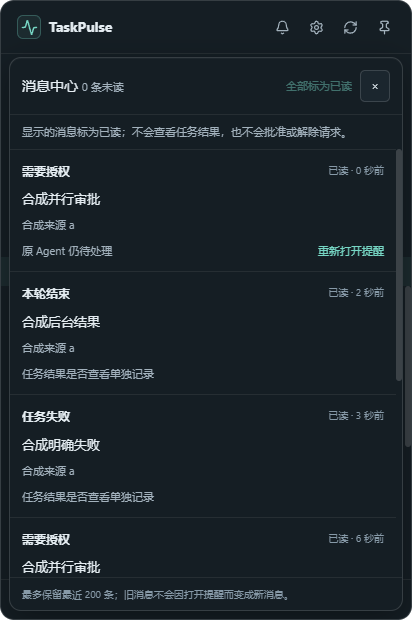
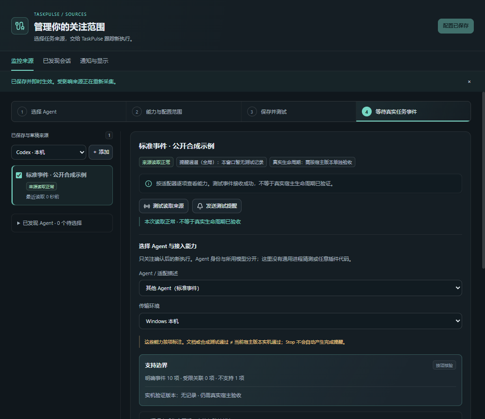
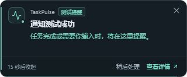
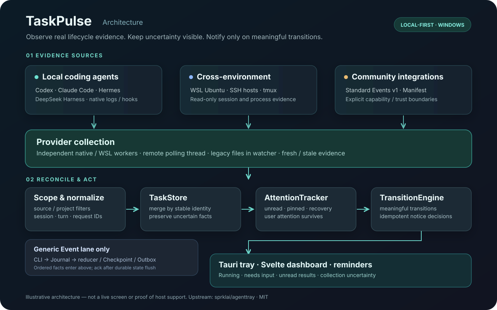

# TaskPulse

**Stay focused on your code. Let TaskPulse watch your coding agents.**

A Windows-first desktop tray companion that brings Codex, Claude Code, Hermes, DeepSeek Harness and other supported sources into one task overview. Get notified when an agent **explicitly requests an answer or approval, or finishes a turn**. Supports selected local, WSL and SSH workflows without changing model or approval settings.

[中文](README.md) · [Getting started](docs/INSTALL.md) · [Compatibility](docs/AGENT_COMPATIBILITY.md) · [Architecture](docs/ARCHITECTURE.md) · [Issues](https://github.com/qingtian-4/TaskPulse/issues)

> **Windows-first · Source preview for the next candidate.** The application version remains 0.2.0-alpha.7. No Alpha.7 installer is publicly available. The source instructions below use the default branch `main`; the updated dashboard, message center and Runtime fixes are absent from the historical Alpha.7 candidate. CI artifacts identify their main SHA separately and do not constitute a new release. [Build and release rules](docs/RELEASING.md).

## At a glance



*Actual Tauri/WebView2 rendering with isolated **synthetic standard events**. This is not a real agent session or evidence that every adapter is host-verified.*

| Task overview | Explicit human requests | Recoverable attention |
|---|---|---|
| See task, agent, project, and source independently | Distinguish approval, question, and tool activity | Independent reminders, unread items, pins, restart recovery |
| Thinking and model waits remain running | Never guess end-of-turn from silence or tool return | Unavailable collection becomes *stale*, not a fake completion |

The dashboard focuses on **running, needs action, and results to review**. Needs action is a subset of running; do not add the counts. The bell counts unread messages only: reading a message neither resolves an agent request nor marks its result viewed.

<details>
<summary>More native screenshots — message center, source management and reminders</summary>







All use isolated synthetic data; the reminder is a clearly labeled test. Previous Alpha.7 screenshots remain as historical materials. [Media provenance](assets/README.md).

</details>

### An everyday workflow

Ask Codex to edit code, Claude Code to review it, and a separate WSL Codex to run tests. TaskPulse helps you find when to switch back without repeatedly opening each terminal. **Approvals and answers still happen in the original agent.**

## Quick start

There is no publicly downloadable Alpha.7 installer. On Windows x64, build from source with Rust 1.89+, Bun, Microsoft C++ Build Tools and the [Tauri 2 prerequisites](https://v2.tauri.app/start/prerequisites/) including WebView2.

```powershell
git clone --branch main --single-branch https://github.com/qingtian-4/TaskPulse.git
cd TaskPulse
bun install --frozen-lockfile
bun run tauri dev
```

Open source management from the tray → choose a source and project scope → save and apply → start a task in the original coding agent → open TaskPulse with `Ctrl+Shift+A`. A successful connection or test notification does **not** prove real host lifecycle support. WSL/SSH are separately configured and never auto-start stopped environments.

[Installation](docs/INSTALL.md) · [Dashboard guide](docs/PRODUCT_DASHBOARD.md) · [WSL](docs/WSL_CODEX.md) · [Development](docs/DEVELOPMENT.md)

## Agent compatibility

| Source | Implemented | Important boundary |
|---|---|---|
| **Codex** | Local native sessions, independent WSL source, SSH sessions | Large history needs initial catch-up; WSL requires Python 3 and an already-running distro |
| **Claude Code** | Local records and optional consented hooks | No dedicated WSL/SSH adapter |
| **Hermes** | Local SQLite and runtime lease | Lease loss is not completion |
| **DeepSeek Harness** | Desktop/CLI and separate WSL source | Local quotas are not remote account quotas |
| **Gemini CLI** | Basic hook/process scanning | Not a full native session adapter |
| **Kimi / TRAE / ZCode** | Partial declarative mappings and fixtures | Not real-host hook-verified |
| **WorkBuddy** | Candidate entry | No event adapter |
| **Custom / community** | Standard Events v1 / declarative Manifest | No general executable plugin loader |
| **Ordinary code runs** | SSH tmux / `tp-run` | Unified local/WSL/SSH execution workflow not delivered; foreground exit does not prove detached, container or Slurm completion |

Source discovery does not establish that turn-completion events are reliable. Kimi / TRAE / ZCode are **fixture-tested**, not native-tested. Linux/macOS builds are opt-in experimental and do not inherit Windows native acceptance. See [the detailed compatibility matrix](docs/AGENT_COMPATIBILITY.md).

## Architecture



1. **Collect evidence** in independent provider workers: native records, hooks, SQLite, bounded file tailers and selected remote sources.
2. **Normalize and reconcile** source/project scope, stable session/turn identity and freshness through TaskStore and AttentionTracker.
3. **Notify meaningful changes** using TransitionEngine; the versioned event lane uses Journal, Checkpoint and Outbox for ordered recovery and deduplication.
4. **Present facts** through Rust/Tauri 2 and Svelte 5: dashboard, independent message center, tray and reminders. Message seen, result viewed and request pending remain separate; a stale task does not become a fresh run or completed turn.

There is no TaskPulse cloud account or telemetry service. Settings and attention normally live in `~/.taskpulse/`; local activity and diagnostics may contain paths or command fragments, so redact before sharing. TaskPulse never auto-installs real hooks or relaxes approval policies. See [demo reproduction and recording](docs/DEMO_RECORDING_PLAN.md).

[Architecture](docs/ARCHITECTURE.md) · [Integration guide](docs/AGENT_INTEGRATION_GUIDE.md) · [Event protocol](docs/AGENT_INTEGRATION_PROTOCOL.md)

## Release readiness

**Available today:** open-source source code, CI regression tests, source management, native UI tests and CI acceptance of Alpha.7 NSIS/MSI installer candidates.

**Not yet accepted for public distribution:** clean-user Windows install/upgrade/uninstall, sustained real-agent lifecycle and notification checks, and a safely redacted screen recording. CI installation and synthetic events are not substitutes for real-host evidence.

[Release checklist](docs/OPEN_SOURCE_CHECKLIST.md) · [Security](docs/internal/reports/SECURITY_AUDIT_2026-10.md)

## Contributing & credits

Issues and adapter contributions are welcome. Share OS, agent version, source type and **redacted** steps; never post credentials or private conversations. [Contributing](CONTRIBUTING.md) · [Security policy](SECURITY.md).

Derived from [sprklai/agenttray](https://github.com/sprklai/agenttray), with upstream credits and Git history preserved. [MIT License](LICENSE).
