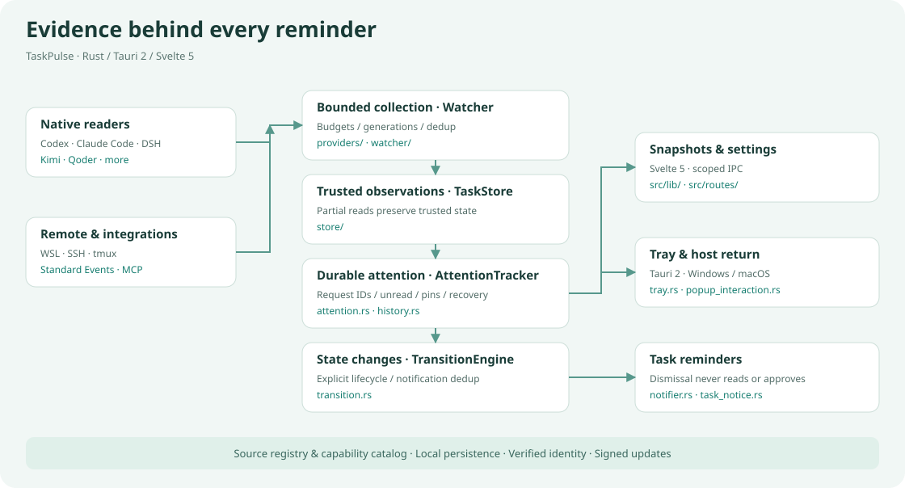

<div align="center">

<picture>
  <source media="(prefers-color-scheme: dark)" srcset="assets/brand/wordmark-dark.svg">
  
</picture>

# TaskPulse

**Stop watching your agents. Come back when they need you.**

Let your coding agents work in the background. Keep your attention on what you are doing.

[Install](#install) · [Get started](#get-started) · [Supported agents](#supported-agents) · [简体中文](README.md)

Windows 10 / 11 · macOS 13.3+ · [MIT](LICENSE)

</div>

TaskPulse keeps track of your coding agents and notifies you when they need approval, input, or attention. Stay focused on your work instead of constantly checking their progress.

## Install

Choose your installer from [GitHub Releases](https://github.com/qingtian-4/TaskPulse/releases):

| System | Installer |
| --- | --- |
| Windows 10 / 11 · x64 | `.exe` or `.msi` |
| Windows 11 · ARM64 | `windows_arm64_setup.exe` |
| macOS 13.3+ · Apple Silicon | `macos_arm64.dmg` |
| macOS 13.3+ · Intel | `macos_x64.dmg` |

Or install with one command. No repository clone or programming tools required.

**Windows · PowerShell**

```powershell
irm https://raw.githubusercontent.com/qingtian-4/TaskPulse/main/install.ps1 | iex
```

**macOS · Terminal**

```sh
curl -fsSL https://raw.githubusercontent.com/qingtian-4/TaskPulse/main/install.sh | bash
```

The scripts install and verify the latest public version. Mac installs to `~/Applications` by default. [OS prompts, version selection and removal](docs/INSTALL.en.md). The source version is **v0.0.1**; Releases lists available downloads. Existing 1.0.x users should read [version migration](docs/INSTALL.en.md#version-migration) first.

## Get started

1. **Choose your sources.** On first launch, confirm agents under Sources → Local and apply your choices. Local data is discovered automatically; add SSH servers when needed.
2. **Work as usual.** Start a task in your agent. The tray panel keeps running tasks, requests and unread results together. On Windows, press `Ctrl+Shift+A` to open it.
3. **Come back when needed.** Answer or approve in the original agent. A matching source event clears the request. Mark a result as viewed after reading it.

Dismissing a reminder, opening details or focusing a host does not mark results as read or approve anything. Adjust notifications, sound, project scopes, text size and updates in Settings.

## Features

- **Focus without waiting:** run several agents without watching every terminal.
- **Know when to return:** reminders for explicit input, approvals, results and failures supported by the source.
- **See what needs attention:** tasks, reported models, effort and duration in a panel that fits up to four cards. Additional tasks scroll inside it.
- **Keep important results:** unread results, pins and unresolved requests survive restarts. Read failures preserve the last trusted state.
- **Connect on your terms:** local agents, multiple SSH servers and project scopes. Configure WSL, Standard Events or MCP when needed.
- **Keep conversations local:** no TaskPulse cloud account or conversation uploads. Agent hooks and approval policies are never changed automatically.

## Task panel

<p align="center"><a href="assets/screenshots/dashboard-en.png"></a></p>

Native Windows interface with example tasks and no private data. Models, effort and start/end times appear only when supplied by the source.

## Task reminders

<p align="center">
  <a href="assets/screenshots/notice-input-en.png"></a>
  <a href="assets/screenshots/notice-approval-en.png"></a>
  <a href="assets/screenshots/notice-completed-en.png"></a>
</p>

Left to right: input, approval and completion. Click an image to view it at full resolution.

## Supported agents

| Agent | Local capability |
| --- | --- |
| Codex | Native tasks, models, explicit questions and outcomes. Approval needs an existing explicit event channel. Separate WSL and SSH sources |
| Claude Code | Native sessions; optional official hooks for explicit approval and lifecycle. Native questions and SSH reading are unsupported |
| DeepSeek Harness | Desktop / CLI tasks, models and effort; native request IDs match questions, approvals and their resolutions |
| Kimi Code / kimi-cli | Main-agent wire journals for turns, models, approvals and questions; coverage depends on the journal format |
| Qoder | Desktop turn projections and IDE / CLI transcripts with complete outcome evidence and duration. Native approval and questions are unsupported |
| OpenCode, WorkBuddy, ZCode, Hermes, Doubao | Native task observations; model, phase and outcome coverage vary |
| TRAE | Public workspace discovery; task state, model and request reading from the current primary store remains limited |
| Gemini CLI and other sources | Process discovery finds running processes only. Full reminders require host-emitted Standard Events or MCP events |

An installed agent does not imply every reminder is supported. Connection, detection, read health and current tasks are separate. Missing evidence never becomes a guessed request or completion. [Capabilities and platforms](docs/AGENT_COMPATIBILITY.md#english) · [Integration guide](docs/AGENT_INTEGRATION_GUIDE.md)

A host is focused only when its live owner can be verified. This does not guarantee an exact session jump; use details to copy a path or session ID when return is unavailable. See the compatibility guide for platform validation.

## How it works

<p align="center"><a href="assets/architecture/architecture-en.svg"></a></p>

Rust owns bounded collection, request matching and durable state. Tauri provides native windows and notifications. Svelte renders the same state snapshot. [Architecture and module ownership](docs/ARCHITECTURE.md)

## Roadmap

- [ ] Broaden explicit native events and agent-version coverage.
- [ ] Improve cross-platform return, multiple displays and sleep recovery.
- [ ] Complete signing, notarization and installer/upgrade runtime coverage.
- [ ] Explore mobile and wearable notifications.

[Full roadmap](ROADMAP.md) · [Usage and troubleshooting](docs/README.md)

## Develop locally

Install Bun, Rust 1.90+ and the [Tauri prerequisites](https://v2.tauri.app/start/prerequisites/), then run:

```sh
git clone --branch main --single-branch https://github.com/qingtian-4/TaskPulse.git
cd TaskPulse
bun install --frozen-lockfile
bun run dev:desktop
```

The development app uses an isolated profile and preserves installed-app data. [CONTRIBUTING.md](CONTRIBUTING.md) covers verification and maintenance conventions.

## Build from source

After installing the prerequisites above, run from the repository root:

```sh
bun run tauri build
```

Installers are written to `src-tauri/target/release/bundle/` by default.

For Windows ARM64, install the MSVC C++ ARM64 build tools and Windows SDK first, then run:

```powershell
rustup target add aarch64-pc-windows-msvc
bun run build:windows:arm64
```

Output defaults to `src-tauri/target/aarch64-pc-windows-msvc/release/bundle/nsis/`. ARM64 downloads are available only when included in that Release; an x64 package is never substituted. [Build prerequisites](https://v2.tauri.app/distribute/windows-installer/#building-for-32-bit-or-arm)

## Contributing and license

[Report an issue](https://github.com/qingtian-4/TaskPulse/issues) · [Contributing](CONTRIBUTING.md) · [Security reports](SECURITY.md) · [Code of conduct](CODE_OF_CONDUCT.md)

Built on [AgentTray](https://github.com/sprklai/agenttray), preserving copyright and contribution history. Licensed under the [MIT License](LICENSE); dependency licenses are in [licenses](licenses/README.md).
