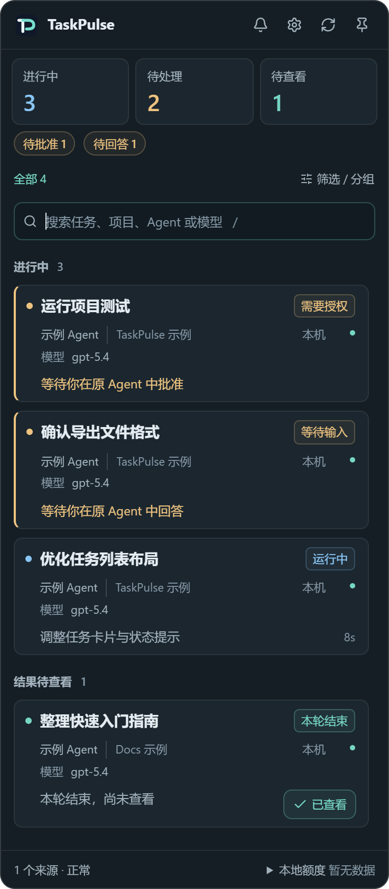
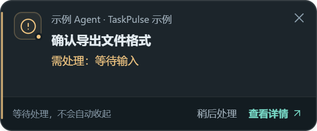
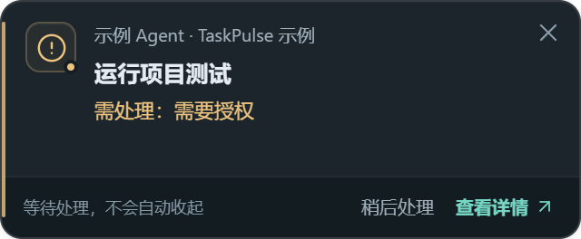
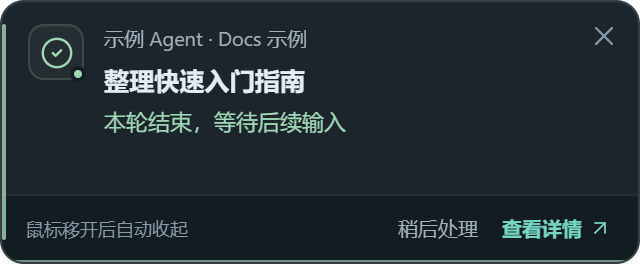

<div align="center">

<picture>
  <source media="(prefers-color-scheme: dark)" srcset="assets/brand/wordmark-dark.svg">
  <source media="(prefers-color-scheme: light)" srcset="assets/brand/wordmark-light.svg">
  
</picture>

# TaskPulse

**Several agents running. Know which one needs you.**

See AI task status, model and elapsed time from your system tray.<br>Get notified when work finishes, fails or needs your attention.

[简体中文](README.md)

<p>  <a href="LICENSE"></a> </p>

</div>

<p align="center">
  
  <br><sub>Windows interface with sample tasks.</sub>
</p>

## Features

- **Find your agents automatically**: confirm detected local sources once, then follow new tasks. Connect WSL and SSH sources when needed.
- **Status, model and time together**: see task titles, projects, reported models and turn duration, with search and grouping.
- **Know when to return**: separate notifications for completion, failure, questions and permission requests.
- **Keep results in view**: unread results remain available; pins and unread state survive restarts.
- **Make it yours**: choose light, dark or system appearance, switch between English and Simplified Chinese, and customize login startup, task details and notifications.
- **Keep your data local**: no TaskPulse cloud account or conversation uploads. TaskPulse never approves Agent requests for you.

## Task notifications

Requests for input or approval stay visible until handled. A completed turn prompts you to review its results.

<p align="center">
  
  <br><sub>Input needed: provide the missing information.</sub>
</p>

<p align="center">
  
  <br><sub>Approval needed: review the execution request.</sub>
</p>

<p align="center">
  
  <br><sub>Task completed: review the turn's results.</sub>
</p>

## Install

### Download an installer

Choose your platform on [GitHub Releases](https://github.com/qingtian-4/TaskPulse/releases):

| Platform | Package |
| --- | --- |
| Windows 10 / 11 · x64 | `.exe` setup wizard or `.msi` |
| macOS 13.3+ · Apple Silicon | `macos_arm64.dmg` |
| macOS 13.3+ · Intel | `macos_x64.dmg` |

### Install with one command

**Windows**: open PowerShell:

```powershell
irm https://raw.githubusercontent.com/qingtian-4/TaskPulse/main/install.ps1 | iex
```

**macOS**: open Terminal:

```sh
curl -fsSL https://raw.githubusercontent.com/qingtian-4/TaskPulse/main/install.sh | bash
```

The scripts select your architecture, verify SHA-256 and install the package. No Bun, Rust or repository checkout is needed. On Mac, the default destination is `~/Applications`. See [installation details](docs/INSTALL.md) for system security prompts and version options.

On first launch, confirm the detected local agents and click **Start monitoring**. Open the tray panel to see tasks; Windows also supports `Ctrl+Shift+A`.

The default panel shows running tasks, explicit requests, unread results and manually pinned tasks. Tasks awaiting fresh source data are available in a separate view, with unread state preserved.

TaskPulse automatically checks for new versions. In **Settings → Application updates**, click to download, verify the signature and install. You can turn automatic checks off or check manually.

## Supported agents

| Agent / task source | Connection |
| --- | --- |
| Codex | Automatic local discovery; separate WSL and SSH sources |
| Claude Code | Automatic local discovery; optional official hooks for precise events |
| Hermes | Native local database and runtime state |
| DeepSeek Harness | Local Desktop / CLI; separate WSL source |
| ZCode | Native local sessions, projects, models and task state |
| Doubao | Native desktop execution state |
| Gemini CLI | Process discovery; task events through a generic integration |
| Kimi Code CLI | Configured Standard Events or MCP integration |
| WorkBuddy | Automatic local discovery of tasks, models and execution records |
| OpenCode | Automatic local discovery of sessions and explicit turn-end records |
| TRAE China IDE | Configured Standard Events or MCP integration |
| Other agents / command-line tasks | Standard Events, MCP, compatible hooks, `tp-run` and remote tmux |

Automatic discovery covers supported native data formats. WSL, SSH and event integrations need configuration. Available states vary by agent; missing models and permission requests are never guessed. [Compatibility](docs/AGENT_COMPATIBILITY.md) · [Integration guide](docs/AGENT_INTEGRATION_GUIDE.md)

## Roadmap

- [x] Local, WSL and remote tasks in one view
- [x] Model display, elapsed time, notifications and unread results
- [x] Windows / macOS packages and command-line installation
- [x] Automatic local discovery and in-app updates
- [ ] Native automatic connections for more agents
- [x] Light / dark themes and Simplified Chinese / English interface switch
- [ ] Android / iOS apps for tasks and notifications after the desktop app is stable
- [ ] Task progress and notifications on smartwatches and fitness bands

## Build from source

Install Bun, Rust 1.90+ and the [Tauri prerequisites](https://v2.tauri.app/start/prerequisites/).

```sh
git clone --branch main --single-branch https://github.com/qingtian-4/TaskPulse.git
cd TaskPulse
bun install --frozen-lockfile
bun run tauri build
```

Packages are written to `src-tauri/target/release/bundle/`. Use `bun run tauri dev` to run locally.

## Contributing and license

[Report an issue](https://github.com/qingtian-4/TaskPulse/issues), improve the docs or contribute an Agent adapter. [Contributing guide](CONTRIBUTING.md) · [Security](SECURITY.md) · [Code of conduct](CODE_OF_CONDUCT.md)

Built on [AgentTray](https://github.com/sprklai/agenttray), preserving its copyright and contribution history. Licensed under the [MIT License](LICENSE).
