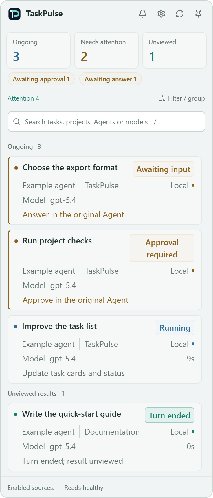
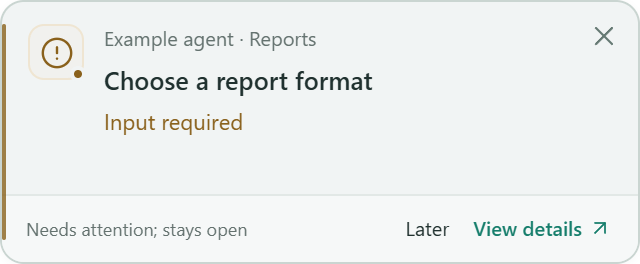
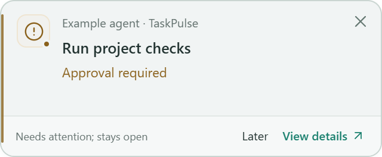
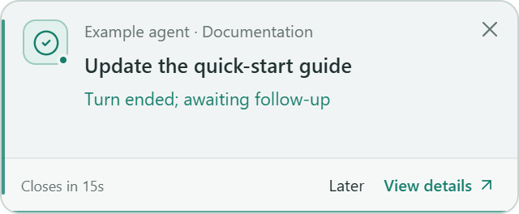
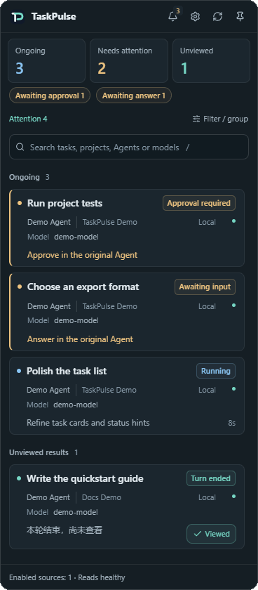

<div align="center">

<picture>
  <source media="(prefers-color-scheme: dark)" srcset="assets/brand/wordmark-dark.svg">
  <source media="(prefers-color-scheme: light)" srcset="assets/brand/wordmark-light.svg">
  
</picture>

# TaskPulse

**Stop watching your agents. Come back when they need you.**

TaskPulse keeps track of your coding agents and notifies you when they need approval, input, or attention.<br>Stay focused on your work instead of constantly checking their progress.

[简体中文](README.md)

<p>  <a href="LICENSE"></a> </p>

</div>

TaskPulse is a lightweight desktop tool that follows tasks across Codex, Claude Code, and other coding agents. It notifies you when an agent requests approval, needs input, completes a task, or encounters an error.

Let several agents work in the background while you focus on what you are doing. Return when a notification calls for your attention. Available notifications depend on the source capabilities listed below.

## Features

- **Stay focused without standing by**: run several coding agents at once without watching terminals or repeatedly checking progress.
- **Get notified when it matters**: receive desktop notifications for input requests, approval requests, completed tasks, and errors.
- **See what needs your attention**: find tasks that need you in a lightweight tray panel, with status, model, and elapsed time available when useful.
- **Keep important results in view**: unviewed results remain available, and pending requests and unread state survive restarts.
- **Discover automatically, connect as needed**: find supported local coding agents automatically and configure WSL, SSH, or other task sources when needed.
- **Run locally and respect privacy**: no TaskPulse cloud account or agent conversation uploads. Operations that need your confirmation stay under your control.

TaskPulse watches your agents so you can focus on your work.

## Task dashboard

<p align="center">
  <a href="assets/screenshots/dashboard-en.png"></a>
</p>

Windows · v1.1.0 · Public sample data in an isolated profile. Click a screenshot to view it at full size.

## Task notifications

Requests for input or approval stay visible until handled. A completed turn prompts you to review its results.

<p align="center">
  <a href="assets/screenshots/notice-input-en.png"></a>
  <a href="assets/screenshots/notice-approval-en.png"></a>
  <a href="assets/screenshots/notice-completed-en.png"></a>
</p>

From left to right: input requested, approval required, and turn ended. Click to enlarge.

## Demo

<details>
<summary>Watch the demo (18 seconds)</summary>

<p align="center"></p>

The demo uses public sample tasks. Requests are resolved by the sample source. TaskPulse never approves them for you, and opening details or dismissing a notification does not mark a task as read.

</details>

## Install

### Download an installer

Choose your platform on [GitHub Releases](https://github.com/qingtian-4/TaskPulse/releases):

| Platform | Package |
| --- | --- |
| Windows 10 / 11 · x64 | `.exe` setup wizard or `.msi` |
| macOS 13.3+ · Apple Silicon | `macos_arm64.dmg` |
| macOS 13.3+ · Intel | `macos_x64.dmg` |

### Install with one command

**Windows**: open PowerShell:

```powershell
irm https://raw.githubusercontent.com/qingtian-4/TaskPulse/main/install.ps1 | iex
```

**macOS**: open Terminal:

```sh
curl -fsSL https://raw.githubusercontent.com/qingtian-4/TaskPulse/main/install.sh | bash
```

The scripts select your architecture, verify SHA-256 and install the package. No Bun, Rust or repository checkout is needed. On Mac, the default destination is `~/Applications`. See [installation details](docs/INSTALL.en.md) for system security prompts and version options.

On first launch, confirm the detected local agents and click **Start monitoring**. Open the tray panel to see tasks; Windows also supports `Ctrl+Shift+A`.

The default panel shows running tasks, explicit requests, unread results and manually pinned tasks. Tasks awaiting fresh source data are available in a separate view, with unread state preserved.

TaskPulse automatically checks for new versions. In **Settings → Application updates**, click to download, verify the signature and install. You can turn automatic checks off or check manually.

## Supported agents

| Agent / task source | Connection |
| --- | --- |
| Codex | Automatic local discovery; separate WSL and SSH sources |
| Claude Code | Automatic local discovery; optional official hooks for precise events |
| Hermes | Native local database and runtime state |
| DeepSeek Harness | Local Desktop / CLI; separate WSL source |
| ZCode | Native local sessions, projects, models and task state |
| Doubao | Native desktop execution state |
| Gemini CLI | Process discovery; task events through a generic integration |
| Kimi Code CLI | Configured Standard Events or MCP integration |
| WorkBuddy | Automatic local discovery of tasks, models and execution records |
| OpenCode | Automatic local discovery of sessions and explicit turn-end records |
| TRAE China IDE | Configured Standard Events or MCP integration |
| Other agents / command-line tasks | Standard Events, MCP, compatible hooks, `tp-run` and remote tmux |

Automatic discovery covers supported native data formats. WSL, SSH and event integrations need configuration. Available states vary by agent; missing models and permission requests are never guessed. [Compatibility](docs/AGENT_COMPATIBILITY.md) · [Integration guide](docs/AGENT_INTEGRATION_GUIDE.md)

For Codex, native questions and approval events use different evidence paths. Claude Code supports explicit approvals through its optional hook; native questions are not supported. Returning to a host window does not mark a task as read. When a source is damaged, over capacity or temporarily unreadable, TaskPulse shows the last known state as uncertain. See [platform and capability notes](docs/AGENT_COMPATIBILITY.md#english).

## Roadmap

- [x] Local, WSL and remote tasks in one view
- [x] Model display, elapsed time, notifications and unread results
- [x] Windows / macOS packages and command-line installation
- [x] Automatic local discovery and in-app updates
- [ ] Native automatic connections for more agents
- [x] Light / dark themes and Simplified Chinese / English interface switch
- [ ] Android / iOS apps for tasks and notifications after the desktop app is stable
- [ ] Task progress and notifications on smartwatches and fitness bands

## Develop locally

Install Bun, Rust 1.90+, and the [Tauri prerequisites](https://v2.tauri.app/start/prerequisites/), then clone the repository and start the development app:

```sh
git clone --branch main --single-branch https://github.com/qingtian-4/TaskPulse.git
cd TaskPulse
bun install --frozen-lockfile
bun run dev:desktop
```

This starts the native tray app with an isolated development profile. See [CONTRIBUTING.md](CONTRIBUTING.md) for daily development, portable builds, and on-demand installer acceptance.

## Build from source

After cloning the repository and installing dependencies as shown above, run this from the repository root:

```sh
bun run tauri build
```

By default, installers are written to `src-tauri/target/release/bundle/`.

## Contributing and license

[Report an issue](https://github.com/qingtian-4/TaskPulse/issues), improve the docs or contribute an Agent adapter. [Contributing guide](CONTRIBUTING.md) · [Security](SECURITY.md) · [Code of conduct](CODE_OF_CONDUCT.md)

Built on [AgentTray](https://github.com/sprklai/agenttray), preserving its copyright and contribution history. Licensed under the [MIT License](LICENSE).
