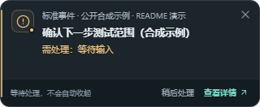
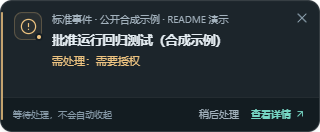

<div align="center">

<picture>
  <source media="(prefers-color-scheme: dark)" srcset="assets/brand/wordmark-dark.svg">
  <source media="(prefers-color-scheme: light)" srcset="assets/brand/wordmark-light.svg">
  
</picture>

# TaskPulse

**Stay focused on your code. Let TaskPulse watch your coding agents.**


[](LICENSE)

[中文](README.md) · [Quick start](#quick-start) · [Supported agents](#supported-agents) · [Roadmap](#roadmap) · [Issues](https://github.com/qingtian-4/TaskPulse/issues)

</div>

TaskPulse brings coding-agent tasks from local, WSL and SSH environments into one desktop tray. Get a reminder when an agent **needs an answer, requests approval or finishes a turn**, without repeatedly checking every window.

> **0.2.0-alpha.8**, not publicly released. [Candidate downloads and testing](docs/CANDIDATE_TESTING.md). Windows first; macOS/Linux are experimental. A mobile companion is planned.

## See it in action

<p align="center"></p>

| Answer needed | Approval needed |
|---|---|
|  |  |

*Actual Tauri/WebView2 screenshots with isolated synthetic standard events. Respond in the original agent; dismissing a reminder does not approve or resolve its request. [Media and reproduction](assets/README.md).*

<details>
<summary>Message center and source management</summary>


</details>

## Features

- **One attention dashboard** for running tasks, pending requests, failures and unviewed results, grouped by agent, project or source.
- **Aggregate tray status** prioritizes requests over errors, unviewed results and running work across concurrent agents.
- **Explicit event reminders** keep thinking and tools running; silence, low CPU or collection failure never imply completion.
- **Recoverable attention** retains unviewed results and pins across restarts. Message seen, result viewed and request resolved stay separate.

## Quick start

For Windows EXE/MSI or Apple Silicon DMG packages, follow the [candidate guide](docs/CANDIDATE_TESTING.md). Source development needs Bun, Rust 1.89+ and the [Tauri prerequisites](https://v2.tauri.app/start/prerequisites/):

```powershell
git clone --branch main --single-branch https://github.com/qingtian-4/TaskPulse.git
cd TaskPulse
bun install --frozen-lockfile
bun run tauri dev
```

Open **source management → select an agent and projects → save and apply**, then start work in the original agent. Open the dashboard with `Ctrl+Shift+A`.

[Installation](docs/INSTALL.md) · [WSL](docs/WSL_CODEX.md) · [Mac development](docs/MACOS_DEVELOPMENT.md) · [Troubleshooting](docs/DEVELOPMENT.md)

## Supported agents

| Source | Current integration |
|---|---|
| Codex | Local native sessions, independent WSL sources and configured SSH sessions |
| Claude Code | Local read-only records and explicitly enabled official hooks |
| Hermes / DeepSeek Harness | Local native data; DeepSeek Harness also has a separate WSL source |
| Doubao Desktop (experimental) | Native Windows running checkpoints; approval unsupported, end reminders not guaranteed |
| Gemini CLI / SSH tmux / `tp-run` | Compatibility hooks, process scanning or run wrappers |
| Kimi / TRAE / ZCode | Partial event mappings, fixture-tested; real-host acceptance pending |
| Other agents | Standard Events, declarative manifests and active reporting from hosts supporting local MCP |

Environment coverage, event support and validation differ by source. See the [compatibility matrix](docs/AGENT_COMPATIBILITY.md) and [integration guide](docs/AGENT_INTEGRATION_GUIDE.md).

## How it works


**Collect evidence → reconcile tasks → track attention → update the tray, dashboard and event reminders.**

Built with Rust, Tauri 2 and Svelte 5. State stays local without a TaskPulse cloud account. Source failures remain uncertain, and approvals stay in the original agent. [Architecture details](docs/ARCHITECTURE.md).

## Roadmap

- [ ] **Mobile companion** to view tasks on paired computers and receive question, approval, failure and completion alerts.
- [ ] **More coding agents**, using official events, native data and MCP, with real-host validation for each integration.
- [ ] **Cross-device experience** with pairing, offline visibility, notification deduplication and reading-state sync.
- [ ] **Desktop reliability** across upgrades, mixed-DPI monitors and extended use.

These are plans: mobile apps and cross-device notifications are not implemented. [Scope and milestones](docs/ROADMAP.md).

## Contributing & license

Issues, documentation and adapters are welcome. Use **feature branch → Pull Request → checks and review → merge into main**. [Contributing](CONTRIBUTING.md) · [Merge workflow](docs/GIT_WORKFLOW.md) · [Security](SECURITY.md).

Derived from [sprklai/agenttray](https://github.com/sprklai/agenttray), with upstream credits and history preserved. [MIT License](LICENSE).
