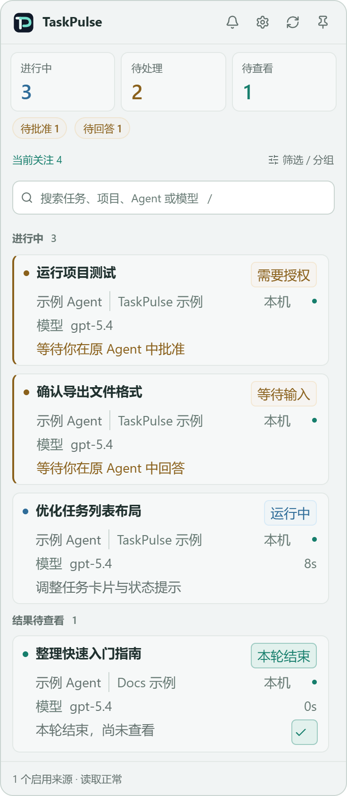
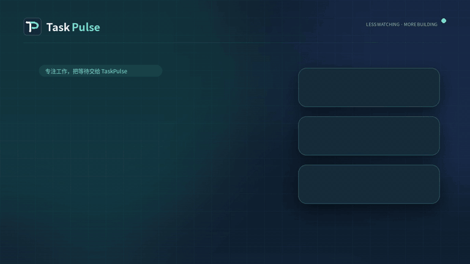
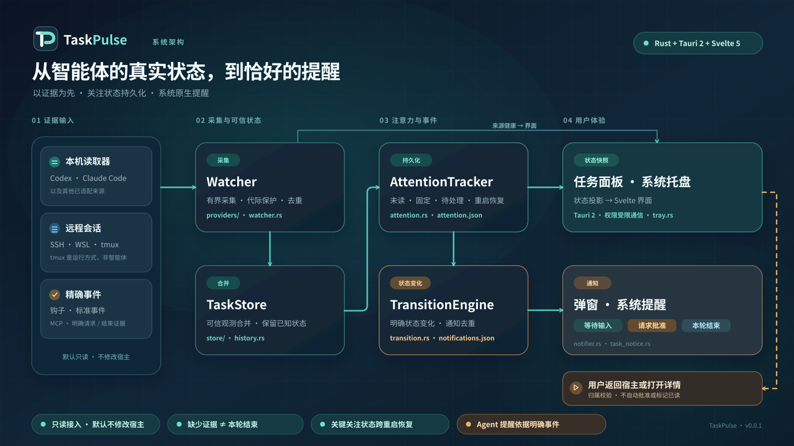

<div align="center">

<picture>
  <source media="(prefers-color-scheme: dark)" srcset="assets/brand/wordmark-dark.svg">
  
</picture>

# TaskPulse

**不必盯着 Agent，需要你时再回来。**

让 Codex、Claude Code 在后台工作，把注意力留给你正在做的事情。

[下载安装](#安装) · [快速上手](#开始使用) · [支持的 Agent](#支持的-agent) · [English](README.en.md)

<p>  <a href="LICENSE"></a> </p>

</div>

TaskPulse 是一款轻量级托盘工具，关注 Codex、Claude Code 等 Agent 的任务。需要回答、批准或查看本轮结果时，收到提醒再回来，无需反复切换窗口检查状态。

## 安装

在 [TaskPulse v0.0.1](https://github.com/qingtian-4/TaskPulse/releases/tag/v0.0.1) 选择对应系统的安装包。

| 系统 | 安装包 |
| --- | --- |
| Windows 10 / 11 · x64 | `TaskPulse_0.0.1_windows_x64_setup.exe` |
| Windows 11 · ARM64 | `TaskPulse_0.0.1_windows_arm64_setup.exe` |
| macOS 13.3+ · Apple Silicon | `TaskPulse_0.0.1_macos_arm64.dmg` |
| macOS 13.3+ · Intel | `TaskPulse_0.0.1_macos_x64.dmg` |

### 命令行安装

**Windows · PowerShell**

```powershell
irm https://raw.githubusercontent.com/qingtian-4/TaskPulse/main/install.ps1 | iex
```

**macOS · 终端**

```sh
curl -fsSL https://raw.githubusercontent.com/qingtian-4/TaskPulse/main/install.sh | bash
```

脚本会自动选择对应架构并校验 SHA-256。[安装、系统提示与卸载](docs/INSTALL.md)

## 开始使用

1. **选择来源**：首次启动，在“监控来源 → 本机”确认要关注的 Agent，点击“确认并开始监控”。本机数据自动发现，服务器可在「SSH 服务器」中添加。
2. **照常工作**：回到 Agent 开始任务，从托盘查看运行、待处理和未读结果。Windows 可按 `Ctrl+Shift+A` 打开面板。
3. **收到提醒再回来**：在原 Agent 中回答或批准。匹配的来源事件解除请求；看完结果后，在任务详情中标记已查看。

关闭提醒、打开详情和聚焦窗口都不会标记已读，更不会代你批准。通知、声音、项目范围、字号与更新均可在设置中调整。

## 功能

- **专注当下，无需守候**：多个 Agent 同时运行，不必一直盯着终端。
- **关键时刻主动提醒**：根据来源的明确证据，提醒输入、审批、任务结果和异常。
- **需要处理的任务，一目了然**：在托盘中集中查看进行中、待处理与结果待查看。
- **重要结果不会错过**：未读结果、固定任务和未解决请求跨重启恢复。读取异常保留上次可信状态。
- **自动发现，灵活接入**：本机来源自动发现，也可连接多台 SSH 服务器，分别设置项目范围。
- **本地运行，尊重隐私**：无需 TaskPulse 云账号，不上传 Agent 对话，不自动修改 Agent Hook 或审批策略。

## 任务面板

**蓝色**表示运行中，**琥珀色**表示等待输入或授权，**青绿色**表示结果待查看。托盘图标使用同一套颜色。卡片显示「本轮结束」时，表示 Agent 已结束这一轮执行。

<p align="center"><a href="assets/screenshots/dashboard.png"></a></p>

<p align="center"></p>

## 任务提醒

<p align="center">
  <a href="assets/screenshots/notice-input.png"></a>
  <a href="assets/screenshots/notice-approval.png"></a>
  <a href="assets/screenshots/notice-completed.png"></a>
</p>

## 支持的 Agent

| Agent / 来源 | 接入与能力 |
| --- | --- |
| Codex | 本机自动发现，也可连接 SSH 服务器。读取会话、模型、本轮状态和明确提问，审批需要[明确事件](docs/CODEX_APPROVAL_OBSERVER.md)。 |
| Claude Code | 本机自动发现，也可用 SSH 读取服务器上的运行和结束状态。明确审批需在本机配置可选官方 Hook；原生提问未支持。 |
| DeepSeek Harness | 读取本机 Desktop / CLI。支持模型、推理强度和明确请求。 |
| Hermes | 读取本机会话、模型和运行状态；会话记录了推理强度时一并显示。 |
| OpenCode | 读取本机会话、运行阶段和明确结束记录。 |
| WorkBuddy | 读取本机任务和本轮结果，不含云端任务。 |
| ZCode | 只读本机任务、模型、本轮推理强度和结果。 |
| Kimi Code / kimi-cli | 只读本机主会话、明确请求和结束记录。 |
| Qoder | 读取本机 Desktop 轮次及 IDE / CLI 日志，原生审批和提问尚未支持。 |
| Trae | 发现本机会话目录。任务进度与完成提醒暂未适配。 |
| 命令行 / 远程 tmux | 可用 `tp-run` 记录前台命令退出码，普通 tmux shell 返回仅提供推断结果。 |

支持的本机数据会自动检测。选择要监控的 Agent 和项目范围即可。各来源的能力与验证范围见[兼容说明](docs/AGENT_COMPATIBILITY.md)。

## 工作原理

<p align="center"><a href="assets/architecture/architecture-zh.svg"></a></p>

Rust 负责有界采集、请求匹配与持久状态，Tauri 提供系统窗口与通知，Svelte 呈现同一份状态快照。[架构与模块职责](docs/ARCHITECTURE.md)

## 路线图

- [ ] 扩展原生事件读取与 Agent 版本覆盖。
- [ ] 完善跨平台返回任务、多屏与睡眠恢复。
- [ ] 完成签名、公证与安装升级的实机覆盖。
- [ ] 评估移动端与可穿戴设备提醒。

[完整路线图 / Roadmap](ROADMAP.md) · [使用与故障排查](docs/README.md)

## 本地开发

安装 Bun、Rust 1.90+ 和 [Tauri 平台依赖](https://v2.tauri.app/start/prerequisites/)，然后运行：

```sh
git clone --branch main --single-branch https://github.com/qingtian-4/TaskPulse.git
cd TaskPulse
bun install --frozen-lockfile
bun run dev:desktop
```

开发应用使用隔离配置目录，保留已安装应用的数据。[贡献指南](CONTRIBUTING.md) 包含检查与维护约定。

## 从源码构建

安装上述依赖后，在仓库根目录运行：

```sh
bun run tauri build
```

默认安装包输出到 `src-tauri/target/release/bundle/`。

构建 Windows ARM64 安装包，需先安装 MSVC C++ ARM64 构建工具和 Windows SDK，然后运行：

```powershell
rustup target add aarch64-pc-windows-msvc
bun run build:windows:arm64
```

默认输出到 `src-tauri/target/aarch64-pc-windows-msvc/release/bundle/nsis/`。[构建前置条件](https://v2.tauri.app/distribute/windows-installer/#building-for-32-bit-or-arm)

## 贡献与许可

[报告问题](https://github.com/qingtian-4/TaskPulse/issues) · [贡献指南](CONTRIBUTING.md) · [安全报告](SECURITY.md) · [行为准则](CODE_OF_CONDUCT.md)

基于 [AgentTray](https://github.com/sprklai/agenttray)，保留版权与贡献历史。采用 [MIT 许可](LICENSE)，依赖许可见 [licenses](licenses/README.md)。
