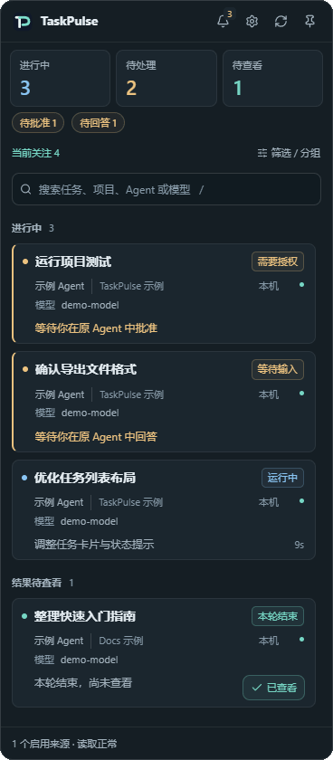

<div align="center">

<picture>
  <source media="(prefers-color-scheme: dark)" srcset="assets/brand/wordmark-dark.svg">
  <source media="(prefers-color-scheme: light)" srcset="assets/brand/wordmark-light.svg">
  
</picture>

# TaskPulse

**不必盯着 Agent，需要你时再回来。**

让多个 Coding Agent 在后台各自执行任务，把注意力留给你正在做的事情。

[English](README.en.md)

<p>  <a href="LICENSE"></a> </p>

</div>

TaskPulse 是一款轻量级桌面工具，统一关注 Codex、Claude Code 等 Coding Agent 的任务状态。当 Agent 需要批准、等待输入、执行完成或发生异常时，它会及时提醒你。

无需反复切换窗口检查进度。收到提醒后，再回来处理真正需要你介入的事情。不同来源提供的提醒能力见下方兼容说明。

## 功能

- **专注当下，无需守候**：多个 Coding Agent 可以同时运行，你不必一直盯着终端或反复检查任务进度。
- **关键时刻主动提醒**：当 Agent 等待输入、请求批准、完成任务或遇到异常时，通过桌面通知及时提醒。
- **需要处理的任务，一目了然**：在轻量级托盘面板中集中查看需要关注的任务，同时按需了解运行状态、模型和耗时。
- **重要结果不会错过**：未查看的任务结果持续保留，待处理和未读状态支持跨重启恢复。
- **自动发现，灵活接入**：支持自动发现已适配的本机 Coding Agent，并可按需配置 WSL、SSH 和其他任务来源。
- **本地运行，尊重隐私**：无需 TaskPulse 云账号，不上传 Agent 对话，也不会擅自批准需要用户确认的操作。

TaskPulse 替你关注 Agent，你只需要专注自己的工作。

## 任务面板

<p align="center">
  <a href="assets/screenshots/dashboard.png"></a>
</p>

Windows · v1.1.0 · 隔离环境中的公开示例数据。点击截图可查看原图。

## 任务提醒

需要补充信息或授权时持续提醒，本轮结束后提醒查看结果。

<p align="center">
  <a href="assets/screenshots/notice-input.png"></a>
  <a href="assets/screenshots/notice-approval.png"></a>
  <a href="assets/screenshots/notice-completed.png"></a>
</p>

从左到右：等待输入、请求批准、本轮结束。点击截图可查看原图。

## 操作演示

<details>
<summary>查看演示（18 秒）</summary>

<p align="center"></p>

演示使用公开示例任务。请求由示例来源解除，TaskPulse 不会代批准；打开详情和关闭提醒不会自动标记已读。

</details>

## 安装

### 下载安装包

从 [GitHub Releases](https://github.com/qingtian-4/TaskPulse/releases) 选择对应系统：

| 系统 | 安装包 |
| --- | --- |
| Windows 10 / 11 · x64 | `.exe` 安装向导，或 `.msi` |
| macOS 13.3+ · Apple Silicon | `macos_arm64.dmg` |
| macOS 13.3+ · Intel | `macos_x64.dmg` |

### 一条命令安装

**Windows**：打开 PowerShell：

```powershell
irm https://raw.githubusercontent.com/qingtian-4/TaskPulse/main/install.ps1 | iex
```

**macOS**：打开终端：

```sh
curl -fsSL https://raw.githubusercontent.com/qingtian-4/TaskPulse/main/install.sh | bash
```

脚本选择对应架构、校验 SHA-256 并安装，无需 Bun、Rust 或克隆仓库。Mac 默认安装到 `~/Applications`。系统安全提示和指定版本等选项见[安装说明](docs/INSTALL.md)。

首次启动，确认发现的本机 Agent 并点击**开始监控**。之后从托盘查看任务；Windows 也可按 `Ctrl+Shift+A`。

默认面板展示运行中、明确待处理、结果未查看和手动固定的任务。来源暂未更新的任务可按需查看，未读状态会继续保留。

应用会自动检查新版本；在**设置 → 应用更新**中点击安装，下载和签名校验完成后重启。也可关闭自动检查或手动检查更新。

## 支持的 Agent

| Agent / 任务来源 | 接入方式 |
| --- | --- |
| Codex | 本机自动发现；另支持独立 WSL 与 SSH 来源 |
| Claude Code | 本机自动发现；可选官方 Hook 提供精确事件 |
| Hermes | 本机原生数据库与运行状态 |
| DeepSeek Harness | 本机 Desktop / CLI；另支持独立 WSL 来源 |
| ZCode | 本机原生会话、项目、模型与任务状态 |
| 豆包 | 本机桌面端原生执行状态 |
| Gemini CLI | 进程发现；任务事件可通过通用接入补充 |
| Kimi Code CLI | 配置标准事件或 MCP 接入 |
| WorkBuddy | 本机自动发现，读取本地任务、模型与执行记录 |
| OpenCode | 本机自动发现，读取会话数据库与明确结束记录 |
| TRAE 中国版 IDE | 配置标准事件或 MCP 接入 |
| 其他 Agent / 命令行任务 | 标准事件、MCP、兼容 Hook、`tp-run` 和远程 tmux |

自动发现适用于已适配的本机数据格式；WSL、SSH 和事件接入按需配置。不同 Agent 提供的状态不同，未提供的模型或审批信息不会猜测。[兼容说明](docs/AGENT_COMPATIBILITY.md) · [接入指南](docs/AGENT_INTEGRATION_GUIDE.md)

Codex 原生提问与审批使用不同的证据通道。Claude Code 可通过可选 Hook 提供明确审批，暂不支持原生提问。返回宿主窗口不会自动标记已读。来源损坏、超出容量或暂时不可读时，TaskPulse 将上次观测标为待更新。详见[平台与能力说明](docs/AGENT_COMPATIBILITY.md)。

## 路线图

- [x] 本机、WSL 与远程任务统一查看
- [x] 模型显示、运行计时、提醒与未读保留
- [x] Windows / macOS 安装包与命令行安装
- [x] 自动发现本机来源、应用内更新
- [ ] 扩展更多 Agent 的原生自动接入
- [x] 浅色 / 深色主题、简体中文 / English 界面切换
- [ ] 桌面端稳定后推出 Android / iOS App，随时查看任务与提醒
- [ ] 支持在智能手表、手环上查看任务进度与提醒

## 本地开发

安装 Bun、Rust 1.90+ 和 [Tauri 开发依赖](https://v2.tauri.app/start/prerequisites/)，然后克隆仓库并启动开发版：

```sh
git clone --branch main --single-branch https://github.com/qingtian-4/TaskPulse.git
cd TaskPulse
bun install --frozen-lockfile
bun run dev:desktop
```

这会启动真实托盘应用，使用独立开发配置。日常开发、便携测试包和按需安装验收见 [CONTRIBUTING.md](CONTRIBUTING.md)。

## 从源码构建

完成上一节的克隆和依赖安装后，在仓库根目录执行：

```sh
bun run tauri build
```

默认安装包输出到 `src-tauri/target/release/bundle/`。

## 贡献与许可

欢迎[反馈问题](https://github.com/qingtian-4/TaskPulse/issues)、改进文档或贡献 Agent 适配器。[贡献指南](CONTRIBUTING.md) · [安全反馈](SECURITY.md) · [行为准则](CODE_OF_CONDUCT.md)

基于 [AgentTray](https://github.com/sprklai/agenttray) 开发，保留原始版权与贡献历史，采用 [MIT License](LICENSE)。
