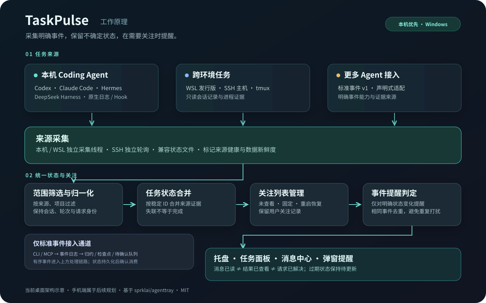

<div align="center">

<picture>
  <source media="(prefers-color-scheme: dark)" srcset="assets/brand/wordmark-dark.svg">
  <source media="(prefers-color-scheme: light)" srcset="assets/brand/wordmark-light.svg">
  
</picture>

# TaskPulse

**专注写代码，其他 Agent 的进展交给 TaskPulse。**


[](LICENSE)

[English](README.en.md) · [快速开始](#快速开始) · [支持的 Agent](#支持的-agent) · [路线图](#路线图) · [反馈问题](https://github.com/qingtian-4/TaskPulse/issues)

</div>

TaskPulse 是一个多 Coding Agent 任务监控器。把本机、WSL 和 SSH 环境中的任务汇总到桌面托盘，在 Agent **需要回答、等待批准或本轮结束**时提醒你，减少反复切换窗口查看进度。

> 当前为 **0.2.0-alpha.8**，尚未公开发布。[候选安装包与测试说明](docs/CANDIDATE_TESTING.md)。Windows 优先，macOS/Linux 为实验支持；手机 App 在规划中。

## 看一眼产品

<p align="center"></p>

| 等待你回答 | 等待你批准 |
|---|---|
|  |  |

*真实 Tauri/WebView2 截图，使用隔离合成任务测试。弹窗提醒你回到原 Agent 处理；关闭提醒不等于批准或解决请求。[素材与复现](assets/README.md)。*

<details>
<summary>消息中心与来源管理</summary>


</details>

## 核心特性

- **统一关注面板**：按 Agent、项目和来源查看进行中、待处理、失败与未查看结果。
- **聚合托盘状态**：待处理优先于异常、未查看结果和运行中，多任务同时执行也能发现阻塞。
- **明确事件提醒**：思考和工具执行仍算运行；日志静默、CPU 空闲或采集失败不会被当成完成。
- **可恢复的关注记录**：未查看结果与固定任务跨重启保留；消息已读、结果已查看、请求已解决分别管理。

## 快速开始

新增 [PowerShell 命令行安装入口](docs/CLI_INSTALL.md)：校验 Release 后打开标准安装向导，支持显式 Alpha、指定版本和仅下载。须等待脚本合入主分支且版本公开；当前 Draft 不可通过命令安装。

测试者从[候选下载说明](docs/CANDIDATE_TESTING.md)获取 Windows EXE/MSI 或 Apple Silicon DMG。源码开发需要 Bun、Rust 1.89+ 和 [Tauri 开发环境](https://v2.tauri.app/start/prerequisites/)：

```powershell
git clone --branch main --single-branch https://github.com/qingtian-4/TaskPulse.git
cd TaskPulse
bun install --frozen-lockfile
bun run tauri dev
```

启动后打开 **来源管理 → 选择 Agent 与项目 → 保存并生效**，然后在原 Agent 中开始任务。使用 `Ctrl+Shift+A` 打开任务面板。

[安装与配置](docs/INSTALL.md) · [WSL 指南](docs/WSL_CODEX.md) · [Mac 开发](docs/MACOS_DEVELOPMENT.md) · [排障](docs/DEVELOPMENT.md)

## 支持的 Agent

| 来源 | 当前接入方式 |
|---|---|
| Codex | 本机原生会话、独立 WSL 来源、已配置的 SSH 会话 |
| Claude Code | 本机只读记录、用户显式启用的官方 Hook |
| Hermes / DeepSeek Harness | 本机原生数据；DeepSeek Harness 另有独立 WSL 来源 |
| 豆包桌面（实验） | Windows 原生运行检查点；审批未适配，结束提醒不保证 |
| Gemini CLI / SSH tmux / `tp-run` | 兼容 Hook、进程扫描或运行包装器 |
| Kimi / TRAE / ZCode | 部分事件映射，fixture-tested，真实宿主验收待完成 |
| 其他 Agent | 标准事件、声明式 Manifest；支持本机 MCP 的宿主可主动上报 |

各来源的环境、事件覆盖与验证程度不同，详见[兼容性矩阵](docs/AGENT_COMPATIBILITY.md)。想接入更多 Agent，请看[接入指南](docs/AGENT_INTEGRATION_GUIDE.md)。

## 工作原理



**采集来源 → 统一任务状态 → 筛选需要关注的任务 → 托盘、面板与事件提醒。**

基于 Rust、Tauri 2 和 Svelte 5。当前状态保存在本机，无 TaskPulse 云账号要求；来源失联保留不确定状态，真实审批仍由原 Agent 处理。[详细架构](docs/ARCHITECTURE.md)。

## 路线图

- [ ] **手机 App**：在手机查看已配对电脑的任务，接收待回答、待批准、失败和完成提醒。
- [ ] **更多 Coding Agent**：扩展官方事件、原生数据和 MCP 接入口，逐个补齐真实宿主验证。
- [ ] **跨设备体验**：设备配对、断线状态、通知去重与阅读状态同步。
- [ ] **桌面稳定性**：完善安装升级、多屏 DPI 与长期运行体验。

以上为规划，手机端和跨设备通知尚未实现。[需求范围与阶段划分](docs/ROADMAP.md)。

## 贡献与许可

欢迎提交问题、文档和适配器改进。代码通过 **功能分支 → Pull Request → 检查与审查 → 合入 main** 协作。[贡献指南](CONTRIBUTING.md) · [合入 main 的说明](docs/GIT_WORKFLOW.md) · [安全反馈](SECURITY.md)。

基于 [sprklai/agenttray](https://github.com/sprklai/agenttray) 开发，保留上游版权与历史，采用 [MIT License](LICENSE)。
