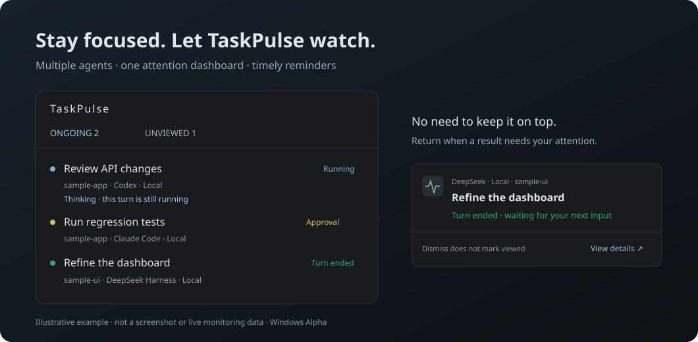

# TaskPulse

**同时开着几个 Coding Agent，不必再一个个切换查看。TaskPulse 一眼汇总任务状态，在本轮结束或明确需要你输入时提醒你。**

[English](README.en.md) · [开发与贡献](CONTRIBUTING.md) · [架构](docs/ARCHITECTURE.md) · [现状审查与改进方案](docs/PROJECT_REVIEW_2026-10.md)

TaskPulse 是基于 [AgentTray](https://github.com/sprklai/agenttray) 开发的独立托盘应用，不是 VS Code 插件。目前准备 **0.2.0-alpha.5 · Windows x64**，不宣称稳定版或支持任意 Agent。



## 安装与开始

[下载／查看预发布](https://github.com/qingtian-4/TaskPulse/releases) · [安装说明](docs/INSTALL.md) · [更新日志](CHANGELOG.md) · [问题反馈](https://github.com/qingtian-4/TaskPulse/issues)

1. 在 Release **Assets** 中下载 `TaskPulse_<版本>_windows_x64_setup.exe`，安装并启动。需要 Windows 10/11 x64 和 WebView2，不需要 Rust/Bun/Node。
2. 确认监控来源并保存：新来源可以关注所有项目的新执行，也可以选择项目。WSL 和 SSH 独立配置。
3. 发送一次“测试提醒”，在启用范围内开始任务。托盘或 `Ctrl+Shift+A` 打开面板，完成/失败结果保留到你标记已查看。

**安装包尚待 CI 与干净系统验收，草稿对普通用户不可见。** 若 Release 没有对应资产，请使用[源码运行](#从源码运行)。`Source code.zip` 不是安装器；未验收的 Portable、Linux/macOS 不作为当前下载承诺。Alpha 的支持范围和剩余验收见[发布门禁](docs/RELEASING.md)。

项目当前展示名为 TaskPulse；包名和可执行文件为 `agent-tray`。

## 功能

- **任务状态汇总**：显示真实会话标题、项目、来源、运行状态和可观测活动。
- **多来源管理**：独立启停本机、受支持的 WSL 来源和 SSH 来源，设置项目范围。
- **任务提醒**：独立弹窗、系统通知或两者同时使用；区分本轮结束、失败、需要授权和需要回答。
- **结果待查看**：保留未查看结果与手动固定状态；关闭提醒不等于标记已查看。
- **远端代码监控**：通过 tmux 进程树观察运行状态，通过 `tp-run` 记录退出码。
- **故障可见**：采集失败保留上次状态并标注过期，服务器失联不会被当作任务完成。

没有明确进度数据时，不生成完成百分比。Agent 一轮回复结束也不代表整个项目已经完成。

## 支持范围

下表描述仓库当前实现，不代表所有 Agent 版本和环境均已通过实机验收。WSL 列指 **Windows 上运行 TaskPulse，监控 WSL 内的数据**；SSH 列指远端原生会话适配。

| 来源 | 本机 | WSL | SSH 服务器 | 边界 |
|---|---|---|---|---|
| Codex | 已实现 | 已实现，按发行版启用 | 已实现 | 元数据与 rollout 日志；远端有截取窗口，不能保证与本机观察完全等价 |
| Claude Code | 已实现 | 无专用适配 | 无专用适配 | 默认只读原生记录；可显式安装生命周期 Hook |
| Hermes Agent | 已实现 | 无专用适配 | 无专用适配 | 读取本机 SQLite 与运行租约；租约过期不判结束，缺少原生结束事件时显示不确定 |
| DeepSeek Harness | 已实现，Desktop/CLI | 已实现，独立来源 | 无专用适配 | 支持旧版与 v4 压缩日志、原生标题投影 |
| Gemini CLI | 兼容 Hook／进程扫描 | 无专用适配 | 无专用适配 | 不等同于完整原生会话适配 |
| ZCode、Trae、WorkBuddy 等 | 无专用适配 | 无专用适配 | 无专用适配 | 可评估官方事件、只读记录或通用状态协议 |

在远端 tmux 中看到某个 Agent 的进程，不等于已经支持它的会话标题、批准请求和每轮结束事件。

| 普通代码运行方式 | 当前能力 |
|---|---|
| 服务器 tmux 中直接执行 | 进程树推断运行与结束；没有退出码时不宣称成功 |
| 服务器通过 `tp-run` 执行 | 记录运行与真实退出码；支持有／无 tmux pane，受来源过滤和采集窗口限制 |
| 本机直接执行任意程序 | 尚无完整的通用运行监控入口；有旧 wrapper 和 `.status` 文件接口 |
| 服务器非 tmux、未使用 wrapper | 尚无通用自动发现与退出码追踪 |
| Windows 监控 WSL 内普通程序 | 尚无专用代码运行 Provider |

当前实现的可靠性限制与补齐方式见[代码运行监控方案](docs/PROJECT_REVIEW_2026-10.md#4-代码运行监控现在怎么用下一步怎么补)。

## 从源码运行

### 环境要求

- Windows 10/11；Linux、macOS 保留兼容代码，但当前主要验证路径是 Windows。
- Rust、Bun，以及 [Tauri 平台依赖](https://v2.tauri.app/start/prerequisites/)。Windows 标准开发路径需要 Microsoft C++ Build Tools 与 WebView2；仓库维护环境也使用 GNU/MinGW 工具链。
- SSH 监控需要可用的系统 OpenSSH 与已配置好的认证；WSL Codex 需要运行中的发行版和 Linux Python 3。

```powershell
git clone https://github.com/qingtian-4/TaskPulse.git
cd TaskPulse
bun install --frozen-lockfile
bun run tauri dev
```

构建桌面安装包：

```powershell
bun run tauri build
```

仅执行 `bun run build` 生成的是前端资源。更多工具链说明见[开发文档](docs/DEVELOPMENT.md)。

### 首次配置

1. 在首次启动的来源管理窗口中确认需要监控的来源并保存。
2. 选择“所有项目的新执行”，或保留自己的项目白名单。历史空闲会话不会批量导入主面板。
3. WSL Codex 单独添加发行版；Windows Codex 来源不会自动包含 Linux 的 `.codex`。详见 [WSL Codex](docs/WSL_CODEX.md)。
4. 远端监控添加自己的 SSH 别名，并选择“Codex · 远程服务器”或“tmux · 远程服务器”。
5. 在“通知与显示”发送测试提醒，确认弹窗或系统通知能够显示。

通过托盘或 `Ctrl+Shift+A` 打开面板。关闭面板后仍继续监控；退出程序使用托盘菜单。

### Claude Code 与 CC Switch

TaskPulse 观察 Claude Code 的会话数据，默认使用 `CLAUDE_CONFIG_DIR` 或 `~/.claude`。通过 CC Switch 切换模型或代理后，Agent 身份仍然是 Claude Code；详情中的模型名是会话上报值，不保证代表代理背后的实际模型。

只读观察不会修改 Claude 配置。需要明确生命周期事件时，可在已保存的本机 Claude 来源中选择“启用精确事件…”并确认；程序备份配置、合并自身 Hook，保留其他 Hook、`statusLine` 和代理设置。移除入口位于同一位置。不同版本与切换配置后的实际事件投递仍需验证。

### 服务器代码任务

先在来源管理中启用该服务器的 tmux 来源，并确保项目范围包含代码目录。

直接在 tmux 中运行时可自动观察：

```bash
tmux new -s research
python train.py
```

要记录真实退出码，可将仓库的 `scripts/tp-run` 复制到服务器，再安装并使用：

```bash
# 在服务器上的仓库目录执行
mkdir -p ~/.local/bin
install -m 755 scripts/tp-run ~/.local/bin/tp-run
~/.local/bin/tp-run "训练实验" -- python train.py
```

`tp-run` 需要 Python 3，也能在 tmux 外生成运行记录。当前仍通过 tmux 来源读取这类记录，需将会话／pane 限定留空，并配置正确项目范围。活跃记录不受 3 小时窗口淘汰；心跳、PID 启动标识和主机 boot ID 用来核对可信度，失联只标为过期，不伪造成功。仅保证被监督的前台命令边界，不代表后台、容器或 Slurm 作业完成；统一 run/attach 工作流仍待实现。验证与限制见[审查执行记录](docs/PROJECT_REVIEW_2026-10.md#11-第一阶段执行记录)。

## 状态与通知

主面板按“进行中 → 结果待查看 → 状态待更新 → 固定与已查看”展示，较早关注保留在独立视图。待批准、待回答、失败结果和来源异常各有紧凑入口，不混为业务失败。

- **运行**：思考、调用工具、生成回复、等待模型响应都属于运行。
- **进行中**：包含实际运行与来源明确报告的批准／提问阻塞；行内仍区分“运行中”和“需要授权”。
- **待查看**：主要是已结束但尚未确认查看的任务结果。Agent 应理解为“本轮结果”，普通命令应结合退出码判断。
- **批准提醒**：仅依据来源明确报告的审批请求。提权参数和长时间未返回的命令不触发授权提醒；如果来源未提供审批事件，可能无法检测授权等待。

默认使用独立、非激活式提醒窗口。完成类提醒约 15 秒后收起，鼠标悬停暂停计时；明确的授权与提问提醒不自动关闭。可切换下一条，关闭提醒不会清除未查看状态。批准操作仍在原 Agent 内完成。

面板右上角铃铛可回查未解决请求，重启后由关注记录恢复。只有新鲜、明确的请求可手动重新打开弹窗，不重发旧完成通知。临时弹窗队列最多 128 条；溢出的结果／请求仍可在面板回查。阻塞提醒有后续消息时会轮转，不会被自动解除。

默认按最近 7 天的执行活动展示关注任务；运行任务和明确手动固定的任务不会因时间过期。较早关注保留原有未查看与固定状态，设置 `recent_days=0` 可关闭时间归档。

## 数据与隐私

TaskPulse 的状态保存在当前用户目录：

| 文件 | 用途 |
|---|---|
| `~/.taskpulse/config.toml` | 来源、项目范围、通知与展示设置 |
| `~/.taskpulse/attention.json` | 关注、未查看、固定和归档状态 |
| `~/.taskpulse/recent.json` | 最近结束任务缓存 |
| `~/.taskpulse/notifications.json` | 跨重启的通知去重 |
| `~/.taskpulse/notification-log.json` | 最多 500 条投递记录，不等于用户已读 |
| `~/.taskpulse/claude-events/` | 启用 Claude Hook 后的事件摘要 |

兼容 `~/.agent-monitor/*.status` 与 `~/.taskpulse/*.status`。服务器的 `tp-run` 默认写入 `~/.local/state/taskpulse/runs/`。

- 无自建云端账户或遥测后端；SSH 使用系统客户端与用户自己的 SSH 配置。
- 不读取 Claude `*.key`，不自动安装 Hook，不自动修改批准策略。
- 不抓取 tmux pane 正文；但原生日志、进程参数、运行记录和活动摘要可能包含命令或路径，分享诊断信息前应检查敏感内容。
- 本机 Codex 账号额度由 Codex app-server 查询，当前没有独立的启用开关，也不代表 WSL 或服务器账号额度。将其改成可选功能属于后续计划。

## 架构与扩展

```text
Provider → 范围过滤 / 标准化 / 去重 → TaskStore
         → AttentionTracker → TransitionEngine → 托盘 / UI / 通知
```

Provider 负责观察和标准化；任务身份、生命周期、展示活动与提醒相互区分。标题改名不会生成新任务；文件消失、日志安静或 CPU 降低不能证明 Agent 完成。

```text
src-tauri/src/providers/     原生、WSL、SSH 与状态文件适配
src-tauri/src/store/         任务合并与来源核对
src-tauri/src/attention.rs   关注列表与归档
src-tauri/src/transition/    生命周期通知与去重
src-tauri/src/task_notice.rs 独立提醒窗口与队列
src/lib/components/         主面板组件
src/routes/manage/          来源管理窗口
src/routes/notice/          提醒界面
scripts/                    wrapper、Hook 与验证脚本
```

新增 Agent 优先接入官方生命周期事件，其次是可验证的只读原生记录；进程扫描只能提供有限线索。当前没有通用第三方插件加载机制。扩展契约与规划见[贡献指南](CONTRIBUTING.md)及[审查报告](docs/PROJECT_REVIEW_2026-10.md)。

## 开发与验证

Windows 托盘程序运行期间，使用隔离构建目录，避免覆盖正在使用的可执行文件：

```powershell
powershell -ExecutionPolicy Bypass -File scripts/verify.ps1 -Frontend
bun run test:ui-model
```

验证脚本包含 Rust 格式检查、Clippy、完整 Rust 测试、可执行文件构建、前端检查与构建。真实 SSH、WSL、Agent 与 WebView2 验收为按需执行，不能用单元测试通过替代。详见 [AGENTS.md](AGENTS.md) 和[脚本说明](scripts/README.md)。

## 后续方向

- 补齐本机／WSL／SSH 普通代码运行的统一入口，优先解决长任务、退出码和中断语义。
- 补齐 Claude Code 的 WSL／SSH 与 Hermes 的 WSL 来源。
- 持续验收运行优先界面与提醒恢复，记录真实来源的检测／通知延迟。
- 为新 Agent 提供稳定的事件接入协议和能力说明。
- 将账号额度查询与展示拆成可选功能。

这些是待实施方向，不是当前支持承诺。

## 贡献与反馈

欢迎提交问题、适配器或文档改进。请先阅读 [CONTRIBUTING.md](CONTRIBUTING.md)；报告问题时提供系统、Agent 版本、来源类型和复现步骤，删除凭据与私人会话内容。适配器变更应包含真实来源验证与状态边界测试。

## 许可证与致谢

采用 [MIT License](LICENSE)。派生自 [AgentTray](https://github.com/sprklai/agenttray)，保留上游版权、许可证与提交历史。更换产品名称不会改变这项归属。
