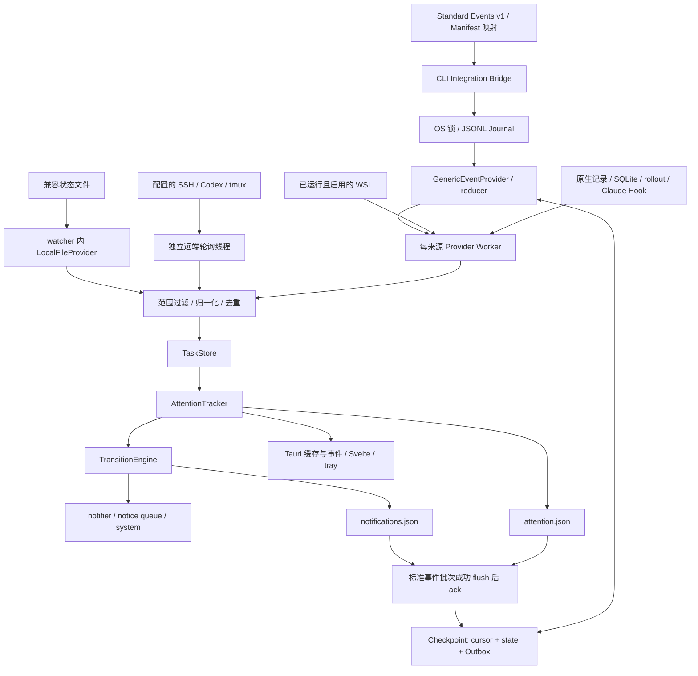

# TaskPulse Architecture

TaskPulse 是 Windows 优先的 Tauri 2 托盘应用；Svelte 5 展示观察结果，Rust 负责采集、身份、关注和通知。支持与验收等级见 [兼容性](AGENT_COMPATIBILITY.md)。

## 入口、托盘与窗口

[`main.rs`](../src-tauri/src/main.rs) 在 Tauri 初始化前处理 Integration Bridge、`--version`、`--claude-event`、`--diagnose` 与系统通知测试。普通启动初始化来源注册表、启动 watcher OS 线程，再创建托盘和 `Ctrl+Shift+A` 快捷键。首次设置或 `--show` 打开面板；隐藏最后一个窗口不退出，显式 Quit 退出。

[`tray.rs`](../src-tauri/src/tray.rs) 延迟创建 `popup` 和独立 `management` 窗口；WebView 创建通过 async / blocking worker 避免 Windows 同步 IPC 死锁。窗口 pin 与任务 pin 独立。[`task_notice.rs`](../src-tauri/src/task_notice.rs) 管理不抢焦点的 `notice` 窗口。三个窗口均须匹配 capability/CSP。托盘 PNG 由 `include_bytes!` 嵌入，不放回 bundle resources。

## 端到端数据流

Journal/Checkpoint/Outbox 属于 Generic Event 通道，不是所有 Provider 共用的事件总线。原生快照与 Claude Hook 有各自采集/重放机制。通知投递和磁盘写入也不是跨进程事务。

## Monitoring 与来源注册表

[`monitoring.rs`](../src-tauri/src/monitoring.rs) 定义 DashboardSettings、SourceConfig、SourceKind，保存实例、位置、项目白名单/排除项和 tmux 范围。首次使用须确认 onboarding；新来源默认所有项目的新执行，已有白名单不会自动扩张。已保存 `[dashboard]` 优先于 legacy monitoring scopes。

`save_monitoring_settings` 校验并原子保存，保留未知 TOML 字段与一次迁移备份；递增 revision，触发刷新和设置事件。Watcher 重设受影响来源 Attention baseline，用 revision 拒绝旧远端批次。`observe` 维护发现目录，包含尚未进入关注的会话；发现不等于导入历史。目录接口每页最多 100 项，底层 catalog 当前没有数量淘汰上限。

## Provider 与 Worker

[`ProviderOutput`](../src-tauri/src/providers/mod.rs) 携带 tasks、catalog、ordered、主机/分段健康及 authoritative。只有完整权威观测才能对对应来源实例清理缺失任务；降级观测不能证明任务结束。

| 来源 / 文件 | 职责 | 隔离及限制 |
|---|---|---|
| [Codex](../src-tauri/src/providers/codex.rs) | thread/SQLite、app-server 元数据、sidebar index、增量 rollout；`codex/questions.rs` 关联异步真实回复 | 1 秒 worker，app-server 另有后台刷新；额度是账号数据；command permission 参数不是审批证据 |
| [Codex WSL](../src-tauri/src/providers/codex_wsl.rs) | 每 distro 独立来源；Linux Python 3 只读 SQLite + session index，UNC 只读 rollout，共用 Codex parser | 2 秒 worker；不唤醒 stopped distro；Linux stat 是 cursor 水位，不以 UNC 时间漂移重置历史 |
| [Claude Code](../src-tauri/src/providers/claude_code.rs) | 只读 projects JSONL、sessions JSON、IDE lock；合并用户明确启用的 Hook envelope | 1 秒 worker；native busy/thinking/idle 不能清除显式 approval 或证明结束；不读 `.key` |
| [Hermes](../src-tauri/src/providers/hermes.rs) | 只读 SQLite session/message 与 runtime lease | 1 秒 worker；租约过期/行消失没有 end 证据时保留不确定状态 |
| [DeepSeek Harness](../src-tauri/src/providers/deepseek_harness.rs) | Desktop/CLI legacy/v4 zstd 日志与 projection；独立 WSL 来源 | native 1 秒、WSL 2 秒；`dsh-native:` 与 `dsh:` ID 分离；旧 projection 不覆盖较新 log state；解压有预算 |
| [Generic Event](../src-tauri/src/providers/generic_event.rs) | 按声明式来源读取 Journal、reduce、checkpoint、发布 ordered facts | 1 秒 worker；ack 后可立即唤醒下一批；仅 local transport |
| [Local file](../src-tauri/src/providers/local_file.rs) | v1 JSON/pipe、v2 hook/wrapper 状态文件 | watcher 内轮询，未使用独立 worker；排除自身状态文件；不是标准事件 v1 通道 |
| [Scanner](../src-tauri/src/scanner/mod.rs) | OS 进程/终端观察、旧 AgentStatus 兼容与 focus metadata | 2 秒 worker；推断证据，不由 CPU/静默判断 Agent 结束 |
| [Remote tmux](../src-tauri/src/providers/remote_tmux/mod.rs) | 每启用 host 一次 SSH snapshot，内部 host 并行；Codex 与 tmux/tp-run 分段 | 独立远端线程、有界结果队列；SSH timeout/坏分段独立降级；前台退出不证明 detached/container/Slurm 工作结束 |

`LocalProviders::configure` 使用上述固定周期，本地 `poll_interval_ms` 并非通用调度器。[`worker.rs`](../src-tauri/src/providers/worker.rs) 的 observation 队列容量 8，刷新请求容量 1，刷新可合并；慢源不阻塞其他 worker。Watcher 约每 100 ms 收取结果，每 2 秒兜底合并；30 秒未返回则将缓存标 stale。文件监听只是刷新提示，polling 继续工作。已进入的阻塞系统调用没有统一强制取消机制。

## 快照与标准事件两条路径

**快照**：Worker tasks/catalog → 每来源 latest cache → scanner/native/terminal 去重 → scope → `TaskStore::merge_instances` → Attention reconcile → `TransitionEngine::apply_snapshots` → 通知与 UI。多个已完成快照可以合并；未被任何轮询观察到的短 turn 无法保证被捕获。

**标准事件**：`--integration-event` / `--integration-host-event` → [`bridge.rs`](../src-tauri/src/integrations/bridge.rs) 限制 stdin、校验来源/manifest/字段 → [`journal.rs`](../src-tauri/src/integrations/journal.rs) 有锁追加 envelope → [`reducer.rs`](../src-tauri/src/integrations/reducer.rs) → 原子保存 cursor + reducer + Outbox → `ProviderOutput.ordered`。Watcher 逐条经 scope、Store、Attention、`apply_ordered`；批次 flush Attention 与通知 ledger 成功后才投递和 ack。失败保留 outbox、回滚 engine 并标降级。

同批已解决的 blocker 不弹出过时提醒。一个 integration 的快照不能抢先消耗另一个 integration 的 outbox。恢复使用 epoch/sequence、event identity 与 task/turn/request 去重。Checkpoint 损坏先保留 `.corrupt.bak` 再重建，重建不是广播历史通知。Manifest 只有受限声明式映射，没有任意可执行插件加载器；内置宿主 Hook 写入须 fingerprint 预览与显式确认。Generic WSL/SSH transport 尚未实现。

## Session / Turn / Request

[`TaskSnapshot`](../src-tauri/src/domain/task.rs) 将稳定身份与展示分开：Session/thread ID 定义任务；name、project、project_path、agent brand 与 reported model 独立。重命名不产生新任务、turn 或通知。`source_instance` 区分 Windows、WSL、SSH 与配置实例；WSL ID 为 `<instance>:codex:<thread-id>`，Linux 项目路径不合并成 Windows 路径。

`turn_key` 定义新执行；fork/subagent 的 origin 不应改变父会话生命周期，internal 会话不进入正常关注/通知。`input_request_id` / `input_request_ids` 保留并行请求，工具结果只按匹配 call ID 清除 activity/请求。`phase`（thinking、tool、responding、model wait）独立于 status，均可保持 RUNNING。`waiting_reason` 区分 approval、question、quota、turn_ended；WAITING_INPUT 不等于需要批准。

EXACT > HOOK > INFERRED 是合并优先级，不是宿主官方保证。stale 表示新鲜度，authoritative 表示本次采集完整度；二者不可互换。缺失文件、CPU 低、断连和工具返回不是 Agent 结束证据。推断结束只允许普通 tmux shell-return，不能附真实 exit code。

## TaskStore 与 Attention 边界

本地 Worker 的独立接收通道同时界定采集 generation。来源 ID、类型、位置或 integration 策略变化会撤销旧通道、缓存和未提交批次；旧线程完成后不能写发现目录。catalog 只由主循环接收当前 Worker 结果后更新。有序事实仍留在 durable outbox，撤销通道不确认消费。native 项目筛选与显示重命名在消费时生效，不重建 WSL/Codex 增量解析器；Generic reducer 捕获的 fallback name 变化则重建该 Worker。

[`TaskStore`](../src-tauri/src/store/mod.rs) 按稳定 ID 合并观测、置信度与来源实例，维护 active/recent。正常运行使用 merge_instances；早期 partition/source helper 仍供兼容、诊断和测试。Agent running 消失保留 stale；普通运行消失变 stale/unknown，不转成功。终态 recent 默认保留 30 分钟，由 [`HistoryStore`](../src-tauri/src/history.rs) 保存。

[`AttentionTracker`](../src-tauri/src/attention.rs) 决定用户继续关注什么：新执行、running、未查看结果、待处理请求与 pin。启动用来源 baseline 避免导入完整 idle 历史。unread、hidden、ignored、manual pin 是 TaskPulse 用户状态。默认 7 天 execution-activity 窗口只改变主视图与 older attention，不删除记录或未读；running 和明确 manual pin 不过期。Legacy pin 保留，但不会自动获得永久豁免。轮询/重命名不续期执行活动。

Attention v4 对可疑 v3 Claude 假历史作保守归档，迁移前必须确认 `attention.json.pre-lifecycle.bak`（更旧版本使用 pre-recency）为完整原始字节的普通文件，不确认已读或删除。备份失败保留原文件并禁用写入。恢复的缓存全部 stale，等待 fresh 来源；运行任务也有 durable attention，已不是“只持久化 recent”。

## Transition、通知与恢复

[`TransitionEngine`](../src-tauri/src/transition/mod.rs) 按稳定 turn/request 生成迁移，`notifications.json` 保存去重，不能因同 turn 抖动或重启重发。apply_snapshots 先 flush 再返回事件；标准事件批次成功 flush 后投递、ack。持久化失败不确认消费。

[`notifier.rs`](../src-tauri/src/notifier.rs) 根据总开关、popup/system/both 和 sound 分发，默认独立 popup。notice 队列最多 128 项；普通结果可自动收起，明确 blocker 没有自动关闭 timer，可轮换。每次 presentation 有独立 notice ID，旧 callback 不能关闭下一条。dismiss、详情、focus 不等于已读或批准。

铃铛消息中心由独立 `message_center` 保存 Notification Seen，与 Attention 的 Task Unread、来源的 Request Pending 分开。明确 Transition 事件经设置/scope 过滤后生成稳定的 task/turn/request/category hash；同目录原子保存 200 条/256 KiB 的有界历史。阅读只确认实际可见行 ID 或显式全读快照 ID；后到消息不被之前的确认吞掉。初次升级不从 Attention 或 delivery log 生成历史新消息，重启阅读状态不复活。上下文临时关联当前 scope 内的 Attention，不持久化标题/参数/回复。读取失败保留原文件并写保护；写入失败可见错误，内存新事件可重试，已读写入失败回滚。

Attention 仍提供折叠的历史待核对请求；重新弹出要求匹配 source、fresh health、明确 pending ID、turn 与 scope，stale/inferred 请求不可重开。手动重开不经过新消息记录。`notification-log.json` 最多 500 条，只表示 queued/rendered/api_accepted 等投递阶段，不证明用户已读，不保存通知 body/命令/prompt。

**投递边界**：ledger 落盘到弹窗/系统 API 接收之间仍有崩溃窗口；Outbox ack 不证明用户看到提醒，没有端到端 exactly-once 可见投递保证。持久未读和请求 inbox 是恢复依据。

## 持久化与预算

通常根目录为 `~/.taskpulse/`。`TASKPULSE_HOME` 隔离本应用状态、host sandbox 与 WebView profile；它不是任意原生 Provider 的通用沙箱，演示必须只启用合成 Generic Event 来源。

| 数据 | 责任 / 恢复 | 边界 |
|---|---|---|
| config.toml | Monitoring 原子保存，迁移备份 | 保留未知字段，首次确认 |
| attention.json | Attention v4、unread/pin/baseline/task | older-view 不是磁盘淘汰，无记录数量硬上限 |
| recent.json | HistoryStore 短期终态快照 | Store 30 分钟 TTL，重启 stale |
| notifications.json | Transition ledger | native 集合可增长；integration ledger 100,000 项后阻止继续确认 |
| notification-log.json | 投递证据 | 500 条，UI 最近 100 条，排除采集/监听触发 |
| messages.json | 独立消息阅读状态，哈希身份与类别 | 200 条 / 256 KiB；不重建历史未读；排除监听触发，生命周期去重仍由 notifications.json 保证 |
| integrations / source hash / events / session hash.jsonl | OS 锁 journal，epoch/sequence | session 32 MiB、source 128 MiB；超额明确拒绝 |
| integrations / source hash / state / session hash.json | cursor/reducer/outbox checkpoint | checkpoint 16 MiB，outbox 4 MiB；每 journal 批次 128 facts / 256 KiB |
| claude-events / session.jsonl 与 .json | Claude 独立 journal + compatibility checkpoint | 不属于 Generic Outbox；新 v3 activity 仅保留工具类别、root 用 hash；本地 cwd 用于项目范围，仍没有等价总磁盘预算 |

关键 JSON 使用同目录临时文件、flush/sync、原子替换，避免半文件；这些文件不组成数据库事务，不能泛称任意损坏均无损恢复。坏状态、迁移备份和配额失败应分别检查。

Attention 与通知账本仅在文件确实不存在时初始化。读取失败、坏 JSON、未知版本或迁移备份失败会锁住本次进程的相应写入；原始文件不会被空状态覆盖。通知账本不可信时不发出生命周期提醒，标准事件批次也不确认消费。Dashboard 的来源异常中显示脱敏的状态故障。先保全原文件并恢复兼容、完整的状态，再重启；进程不会自动重试覆盖人工修复。通知账本新增 version=1，仍可读取无 version 的旧账本。

## WSL / SSH 隔离与安全

Codex WSL 检查 running 清单，通过 Linux Python 只读 SQLite/WAL，UNC 仅读 rollout；局部失败不清空可信任务。DSH native/WSL 独立，压缩输入/解压输出有预算。SSH 使用系统客户端 BatchMode、超时和参数验证；凭据由系统 SSH 管理，host 并行，Codex/tmux 分段健康独立。失败保持 stale，不冒充结束或重置通知 baseline。

Tail/parser 缓存有预算与 active 状态保护，冷历史逐步 catch-up；这不代表整个应用历史/内存均有硬上限。SSH 输出、目录与关注状态仍待加固。TaskPulse 不自动安装真实 Hook、修改代理/模型/审批策略、唤醒停止 WSL、执行 Code Mode 或付费任务，不依靠 OCR/截屏采集任务状态。

## 前端、CI 与原生验证

`src/routes/+page.svelte` 仅承载 [Dashboard](../src/lib/components/Dashboard.svelte)。它订阅 agents/archived-attention/providers/pending-prompts/quota/settings 等 Tauri 事件，并在启动、聚焦、刷新时通过 get_agents 等 IPC 获取缓存。刷新返回请求时间戳，UI 等待各源本次 completed attempt；多个缓存/事件没有统一 generation，展示是最终一致。

[Manage](../src/routes/manage/+page.svelte) 获取配置、发现目录、integration preview/confirmation；即时开关与未保存 editor draft 分离。[Notice](../src/routes/notice/+page.svelte) 获取 NoticeState 并回报 rendered，不改变 Attention 已读。Dashboard 展示 ongoing/results/uncertain/pinned；失败是结果，来源故障是不确定，thinking/model wait 仍 ongoing。

浏览器 dev demo 不能验收 native IPC、CSP、窗口线程、焦点或宿主支持。native-product / native-integration / native-notice smoke 使用实际 WebView2 与隔离合成事件；installer CI 在独立 fresh runner 分别验收 NSIS/MSI。quality、security、release 工作流独立；release 只创建 draft prerelease，不自动公开。Linux/macOS 为 opt-in experimental，不能继承 Windows 验收。具体构建结果以对应 CI 的源码 SHA 和 evidence artifacts 为准。

## 模型元数据与分发边界

Provider 将可选 `model` 沿现有 TaskStore/Attention/IPC 链路传入 UI。Codex 原生上下文、
Claude assistant、DSH 会话/日志与 Hermes SQLite 是证据来源，空值不推测。模型不参与稳定身份、
生命周期或通知键；来源更新时间不替代本轮开始时间。实现与验证边界见[兼容矩阵](AGENT_COMPATIBILITY.md#模型信息与本轮计时)。

安装 bootstrap 消费相同的 Release 安装器/DMG，PR preview 仅上传带精确 SHA 的测试附件。
公开 CLI 拒绝 Draft 与 `pr-preview` manifest；正式标签/准确 main 校验仍由原发布流程执行。
