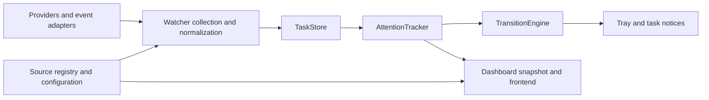

# TaskPulse architecture map

TaskPulse uses Rust/Tauri 2 for collection, durable attention and native delivery,
with Svelte 5 and Bun. [Development](../CONTRIBUTING.md) and
[maintenance](../.agents/skills/taskpulse-maintenance/SKILL.md) describe how to change it.

[中文架构图](../assets/architecture/architecture-zh.svg) · [English diagram](../assets/architecture/architecture-en.svg)

The SVGs are editable source assets. The flow below and ownership table are the
reference for implementation. Kimi separates filesystem admission (`kimi.rs`),
pure wire reduction (`kimi/wire.rs`) and regression cases (`kimi/tests.rs`).
Qoder readers separate Desktop SQLite projections from IDE/CLI transcripts.
TRAE's public metadata reader does not claim full lifecycle support.

| Owner | Responsibility and boundary |
| --- | --- |
| `src-tauri/src/providers/`, `integrations/` | Read native/remote evidence and validate Manifest/Standard Events/MCP input. Produce observations/health without inventing completion or approval. |
| `watcher.rs`, `watcher/dedup.rs` | Coordinator owns bounded collection, generation guards, source health and consistent publication. The child module owns pure observation dedup, without scheduling or persistence. |
| `store/`, `attention.rs`, `history.rs` | Reconcile authoritative observations, retain durable unread/pin/request state and archive old attention. Partial/missing data is not a terminal event. |
| `transition.rs`, `notifier.rs`, `task_notice.rs` | Deduplicate lifecycle notifications and manage presentation. Dismissal/focus is not user-read. |
| `monitoring.rs`, `monitoring/discovery.rs`, `source_catalog.rs` | Registry owns source IDs, migration/CAS and catalog state. Discovery is read-only. The catalog owns shared capability metadata. Support, detection, health and current tasks stay separate. |
| `popup_interaction.rs`, `tray.rs`, native window/startup/focus modules | Backend visibility/focus and OS resources. Validate live identity and release locks before native setters. |
| `src/lib/`, `src/routes/` | Typed presentation and IPC clients. Shared stores own preferences/drafts. SourceSettings owns editing and management close protection. |
| `locales/` | One pair of app-owned catalogs for Svelte and native Rust, with key-consistency tests. Native task/source text stays data. |
| `scripts/`, package scripts, `.github/workflows/` | Build/development/audit/delivery entrypoints, with stable shipped runtime resources. |
| `tests/`, `tests/native/`, `tests/install/`, `tests/support/`, `tests/fixtures/` | Automated contracts, opt-in native/installation acceptance, shared lifecycle helpers and sanitized inputs. |

Protocols stay in [integration protocol](AGENT_INTEGRATION_PROTOCOL.md),
`src-tauri/src/integrations/schema.rs` and the integration manifests. Adapter
behavior stays in its tests and [compatibility guide](AGENT_COMPATIBILITY.md).
No second plugin system, event pipeline or copied locale/schema is needed.

Public `install.ps1` / `install.sh`, `scripts/tp-run`, wrappers, Codex observer and
`scripts/hooks/` retain their paths. Tauri bundles the Hook directory and license
resources. A runtime script is not disposable because it lives under scripts.
Keep sanitized fixtures, locks and `licenses/sources.json` with their consumers.

Organization references are [agent-speed's shared specifications](https://github.com/zoefix/agent-speed/tree/main/spec)
and [agent-autoloop's responsibility boundaries](https://github.com/KKKKhazix/agent-autoloop/blob/main/AGENTS.md).
TaskPulse retains its own stack, UI, lifecycle and compatibility rules.
